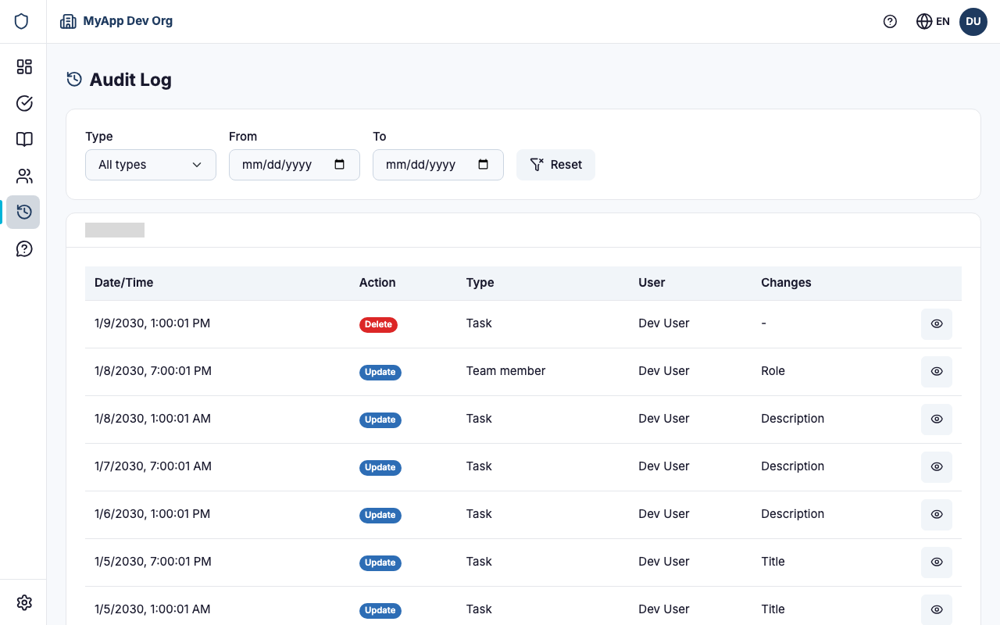
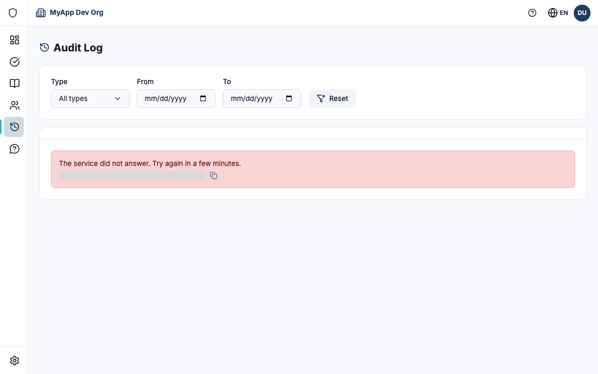

# Open the audit trail

Read the list of changes made in your organization, to see who changed what and when.

## Before you start

- Only Admins can open the audit trail. Editors and Viewers do not see the "Audit Log" link; if they open the page by its address, they are taken to the Dashboard with the message "You don't have access to this page."

## Steps

1. In the menu, click "Audit Log".

   

## What you will see

- A table with the columns "Date/Time", "Action", "Type", "User" and "Changes". The type is "Task", "Team member", "Organization" or "User".
- The newest change at the top, and above the table a count of all the changes listed.
- 25 changes per page. "Previous" and "Next" move between pages and the position is shown as "1 / 3".
- The action is "Create", "Update" or "Delete", with the name of the person who made the change.
- For an "Update", the "Changes" column lists the fields that changed, such as "Title". For "Create" and "Delete" it shows "-".
- Times are shown in the time zone of your device.
- When there are no changes yet, the table reads "No audit logs found."

## Good to know

- Only the changes of the organization currently selected are listed, and only those of the last year.
- Creating, changing or deleting the organization, its team members, its tasks and its users is recorded.
- Nobody can edit or remove a recorded change.
- You cannot export, print or undo changes, and the audit trail does not record who opened or viewed data.

## If something goes wrong

| What you see | What to do |
|---|---|
| "The service did not answer. Try again in a few minutes." | Reload the page later. |

## Related pages

- [Filter the audit trail](US-AUD-02.md)
- [See what changed in an entry](US-AUD-03.md)
