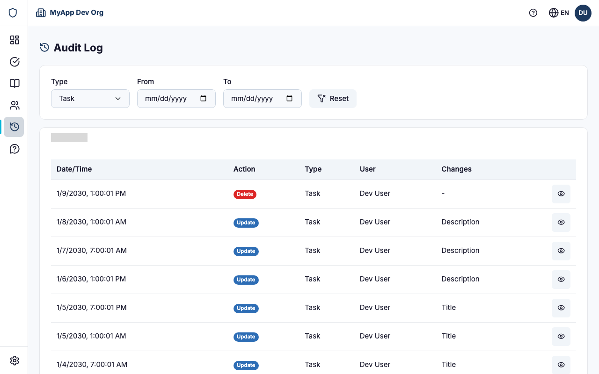

# Filter the audit trail

Narrow the list of changes by type and by date, to find a specific change quickly.

## Before you start

- Only Admins can open the audit trail.

## Steps

1. In the menu, click "Audit Log".
2. In the "Type" field, choose a type such as "Task".

   
3. To look at a period, choose dates in "From" and "To".
4. To see everything again, click "Reset".

## What you will see

- Only the changes of the chosen type, and a lower count above the table.
- With dates, only the changes made from the start of the first day to the end of the last day, by the time on your device.
- With type and dates together, only the changes that match all of them.
- Whenever you change a filter, the first page of the result is shown.
- When nothing matches, the table reads "No audit logs found."

## Good to know

- The "Type" field starts as "All types" and always offers "Task", "Team member", "Organization" and "User", whatever is listed.
- Filters search the whole history of the organization, not only the page you are on.
- You cannot filter by user, search by text or save a filter for later.

## Related pages

- [Open the audit trail](US-AUD-01.md)
- [See what changed in an entry](US-AUD-03.md)
