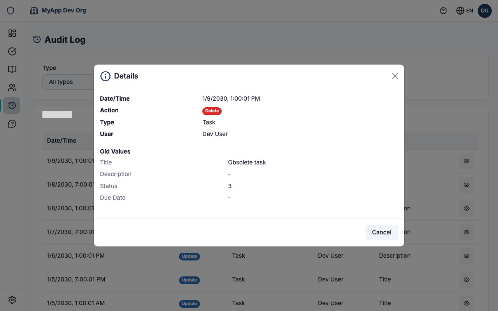

# See what changed in an entry

Open a change and see the values before and after it, to understand exactly what was modified.

## Before you start

- Only Admins can open the audit trail.

## Steps

1. In the menu, click "Audit Log".
2. On the row of the change, click the "Details" button (the eye). The "Details" dialog opens.

   
3. Read the dialog, then click "Cancel" to close it.

## What you will see

- The "Date/Time", "Action", "Type" and "User" of the change.
- For an "Update", "Old Values" and "New Values" with only the fields that changed, for example "Title".
- For a "Create", only "New Values", with the data entered.
- For a "Delete", only "Old Values", with the data that was removed.
- Fields and values are named as on the screens where they are edited, for example the status "In Progress".
- After you close the dialog, the list is as you left it.

## Good to know

- Old values exist only for updates and deletions; new values exist only for creations and updates.
- You cannot restore the old values or compare two entries side by side.

## Related pages

- [Open the audit trail](US-AUD-01.md)
- [Filter the audit trail](US-AUD-02.md)
