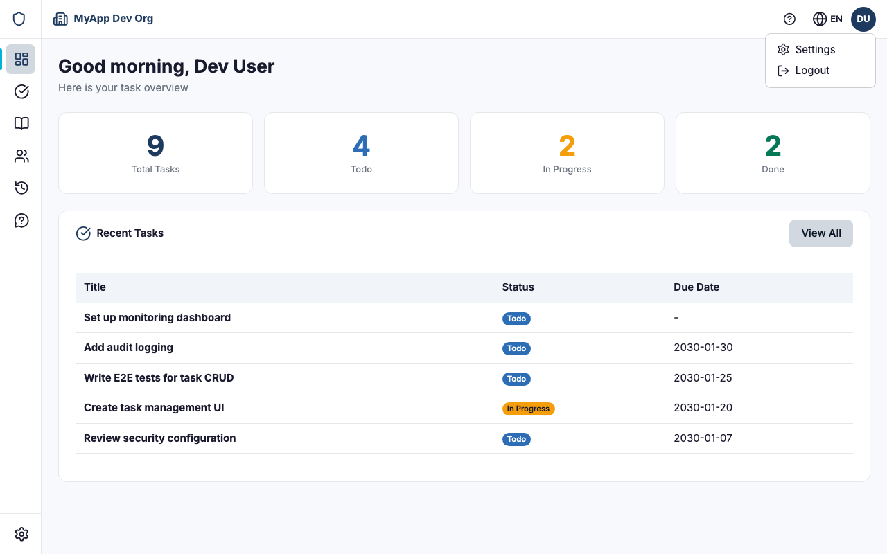
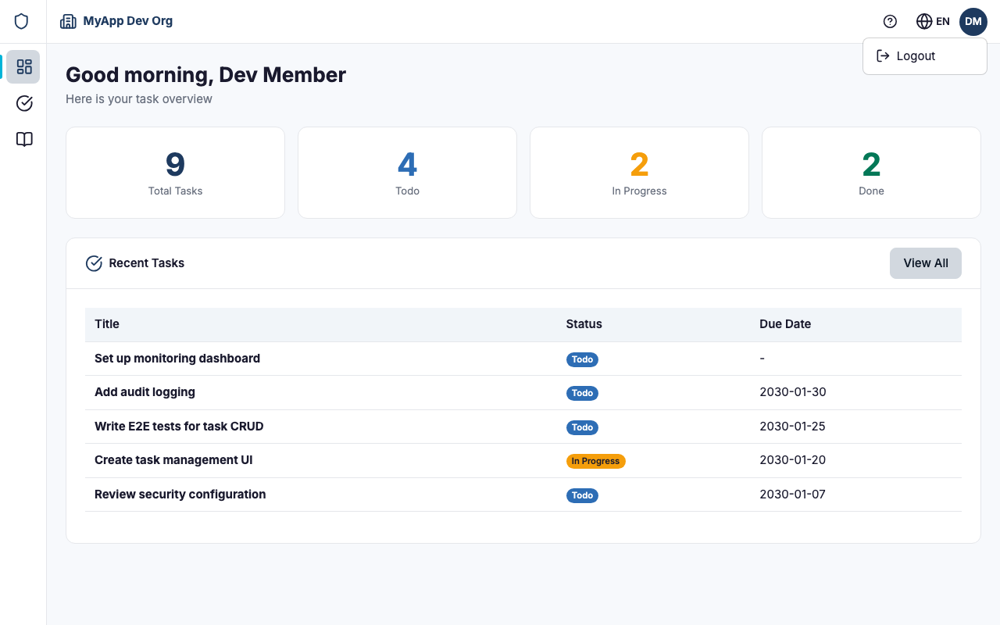

# Sign out of the app

Sign out when you finish, so that nobody else can use your account on this device.

## Steps

1. Click the round button with your initials at the top right of any page. A menu opens.

   

2. Click "Logout". If you are not an Admin, the menu offers only this entry.

   

3. The sign-in page opens.

## What you will see

- The sign-in page opens.
- Opening any page of the app now asks you to sign in again.

## Good to know

- Signing out ends the session on this device only. It does not sign you out on your other devices.
- Signing out does not delete your account or the data of your organization.
- The app does not ask you to confirm before signing you out.
- Admins also find "Settings" in this menu.

## Related pages

- [Sign in with your email address](US-AUTH-01.md)
- [Get asked to sign in before using the app](US-AUTH-02.md)
