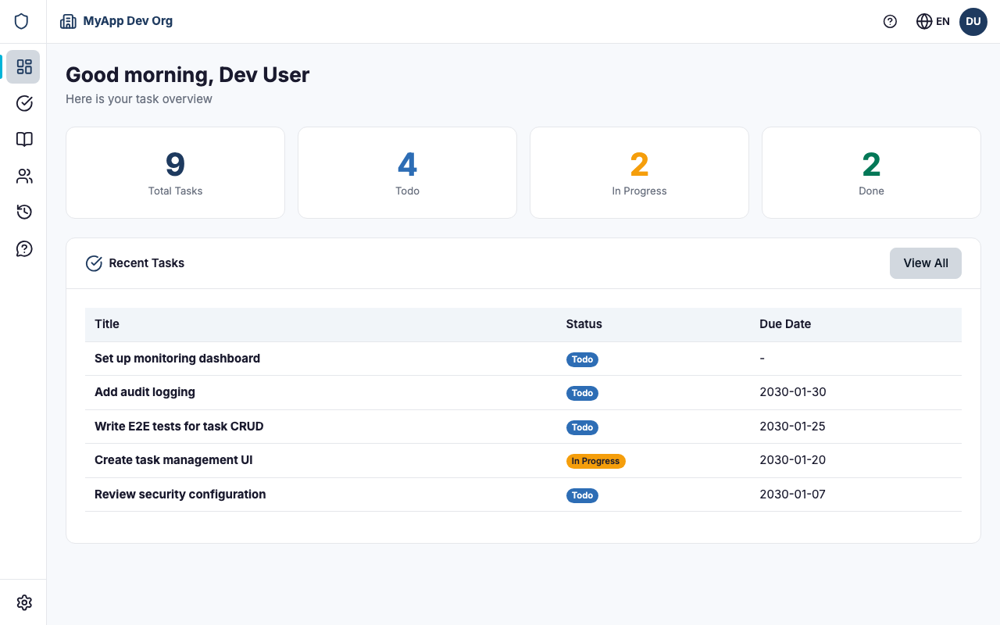
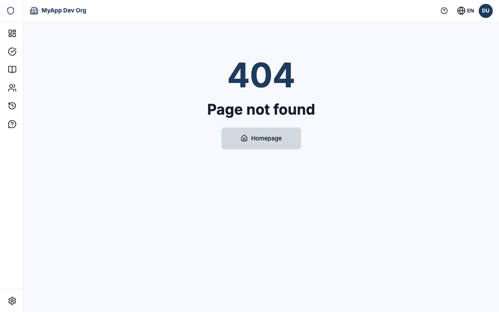

# Move between the sections of the app

Use the menu on the left to go to the sections of the app. The header shows the organization you are working in.

## Steps

1. Sign in. You land on the Dashboard page.
2. Look at the menu on the left. It lists "Dashboard" and "Tasks"; Admins also see "Team" and "Audit Log", and "Settings" at the bottom.

   

3. Click an entry to open its page. The entry of the open page is highlighted.
4. If you belong to several organizations, click the name of the current one in the header and choose another. Every page then shows the data of the chosen organization.
5. If you end up on an address that does not exist, click "Homepage" to go back to the Dashboard page.

   

## What you will see

- The header of every page shows the name of the current organization.
- Only the entry of the page that is open is highlighted.

## Good to know

- Searching the app from the header and changing the order of the menu entries are not available.

## Related pages

- [Open only the pages your role allows](US-AUTH-07.md)
- [Move between pages with the keyboard](US-AUTH-09.md)
