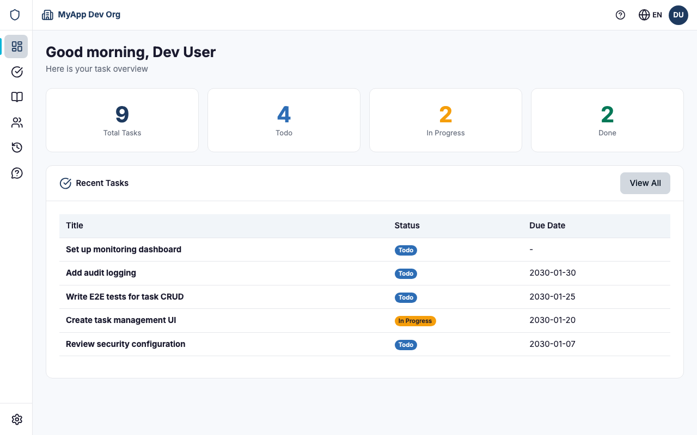
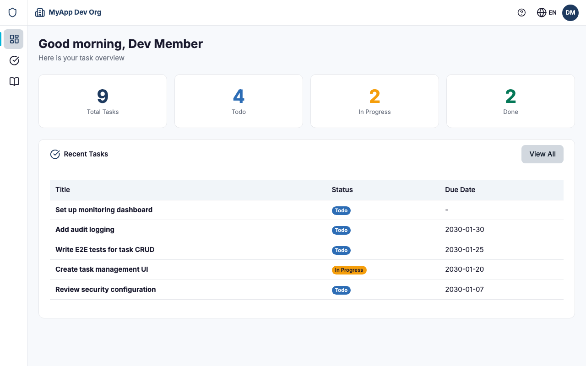

# Open only the pages your role allows

The management pages are open only to Admins. Editors and Viewers see only the pages they can use.

## Before you start

- Admins see every entry. Editors and Viewers cannot open the management pages.

## Steps

1. As an Admin, look at the menu on the left: it lists "Dashboard", "Tasks", "Team", "Audit Log" and "Settings".

   

2. As an Editor or a Viewer, the menu lists only "Dashboard" and "Tasks", and the avatar menu offers only "Logout".

   

3. If you open an Admin page by its address, the Dashboard page opens with the message "You don't have access to this page."

## What you will see

- Admins can open the Team, Audit Log, Organization and Update Organization pages.
- Admins, Editors and Viewers can all open the Dashboard and Tasks pages.

## Good to know

- What you can do depends on your role in the organization currently selected in the header.
- The role of a member is changed on the Team page, by an Admin.

## Related pages

- [Get asked to sign in before using the app](US-AUTH-02.md)
- [Move between the sections of the app](US-AUTH-06.md)
