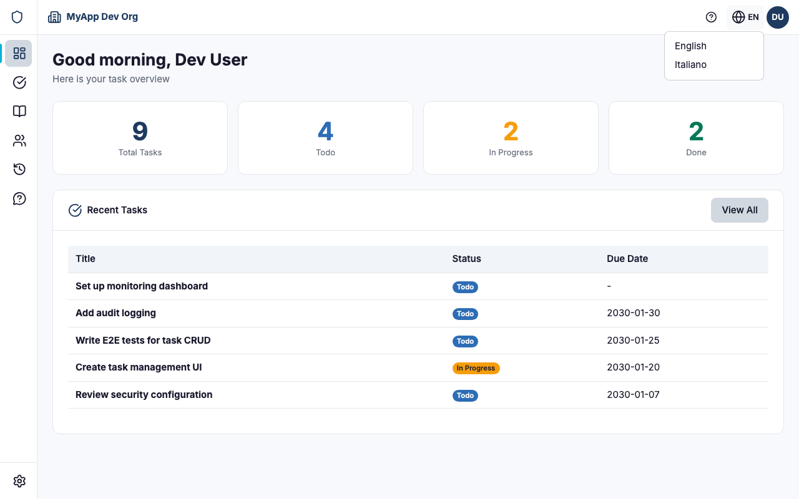

# Change the app language

Switch the app between English and Italian whenever you like. The change is immediate.

## Steps

1. Click the "Change language" button in the header. It shows the current language, **EN** or **IT**, and is available on every screen size.

   

2. Click "Italiano" or "English".
3. The menu, the labels and the messages change at once, without reloading the page, and a message confirms the choice.

## What you will see

- A message confirms the change, for example "Language changed to English".
- The language is kept the next time you sign in, on any device.

## Good to know

- Only English and Italian are offered. A new account starts in English.
- The language belongs to you, not to the organization: changing it does not change it for your colleagues.
- What people typed, such as task titles, is not translated.

## If something goes wrong

| What you see | What to do |
|---|---|
| "The service did not answer. Try again in a few minutes." | The app keeps your language only until you sign out. Choose the language again later, so that it is kept at your next sign-in. |

## Related pages

- [Start using the app on first sign-in](US-AUTH-04.md)
- [Move between the sections of the app](US-AUTH-06.md)
