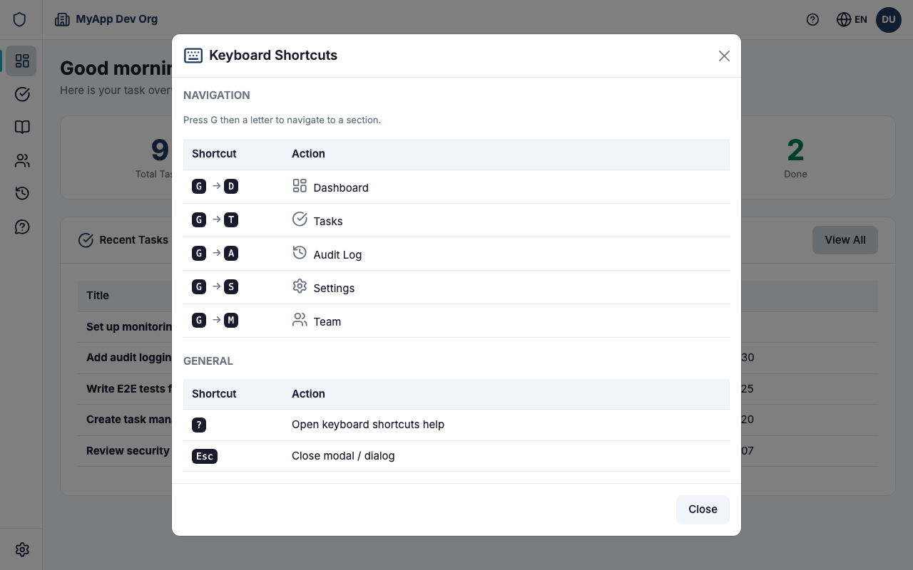
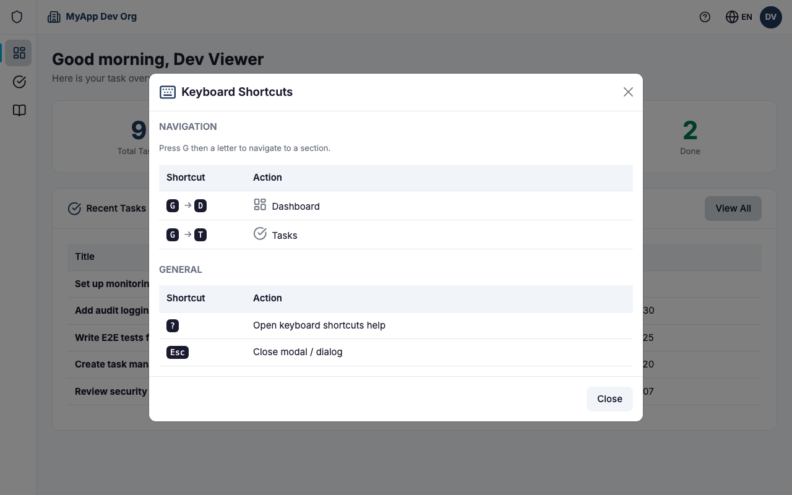

# Move between pages with the keyboard

Open the main pages with a few key presses, without the mouse.

## Steps

1. Press **G** and then **D** to open the Dashboard page, or **G** and then **T** to open the Tasks page.
2. As an Admin, press **G** and then **M** for the Team page, **G** and then **A** for the Audit Log page, or **G** and then **S** for the Organization page.
3. Press **?** to open the "Keyboard Shortcuts" dialog. It lists only the shortcuts you can use.

   

4. As an Editor or a Viewer, the dialog lists only the Dashboard and Tasks shortcuts.

   

## What you will see

- The page of the shortcut you pressed opens.

## Good to know

- Editors and Viewers have only the shortcuts of the Dashboard and Tasks pages: G followed by M, A or S does nothing for them.
- Shortcuts do nothing while you type in a field or while a dialog is open: keys typed in a field are text.
- You cannot choose other keys, and there are no shortcuts for actions inside a page, such as creating a task.

## Related pages

- [Move between the sections of the app](US-AUTH-06.md)
- [Open only the pages your role allows](US-AUTH-07.md)
