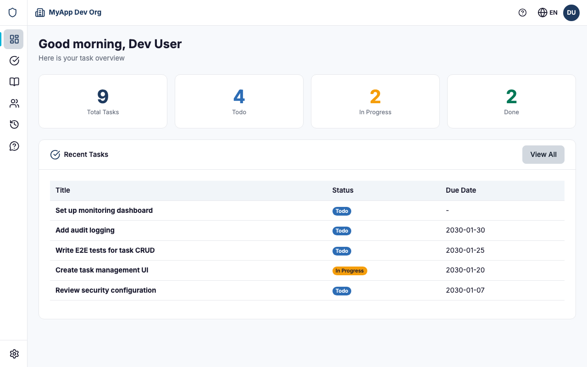
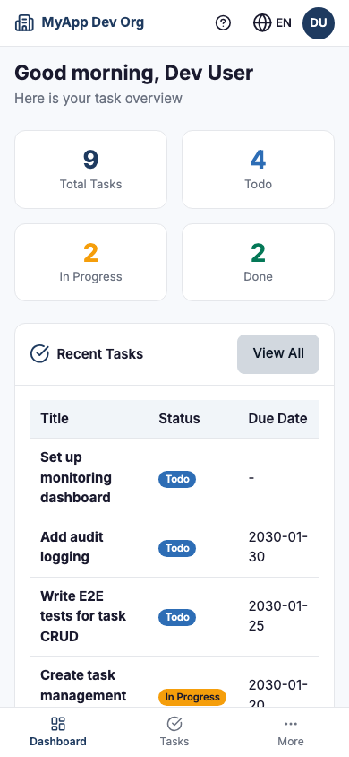
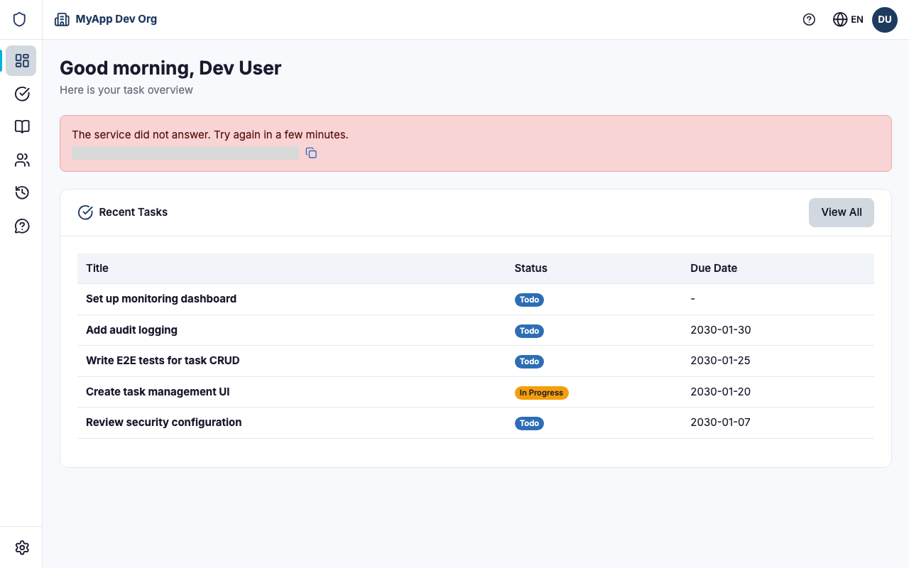

# See my task counts

See how many tasks your organization has in each status, for a quick picture of the workload.

## Steps

1. In the menu, click "Dashboard". It is also the first page you see after signing in.

   

## What you will see

- Four cards: "Total Tasks", "Todo", "In Progress" and "Done", each with a number.
- While the numbers load, a spinner is shown in their place.
- On a wide screen the cards sit in one row; on a narrow screen they sit two per row.
- An organization without tasks shows 0 on every card.

## Good to know

- "Total Tasks" counts every task of the organization, including the cancelled ones. Cancelled tasks are not counted on the other cards.
- The numbers always describe the organization currently selected, and everyone in it sees the same figures.
- You cannot choose a period or a person, and clicking a card does not open the task list.

## If something goes wrong

| What you see | What to do |
|---|---|
| "The service did not answer. Try again in a few minutes." | Reload the page later. |

## Related pages

- [See my latest tasks](US-DASH-02.md)
- [Open the task list from the dashboard](US-DASH-03.md)
- [Read a greeting on the dashboard](US-DASH-04.md)
