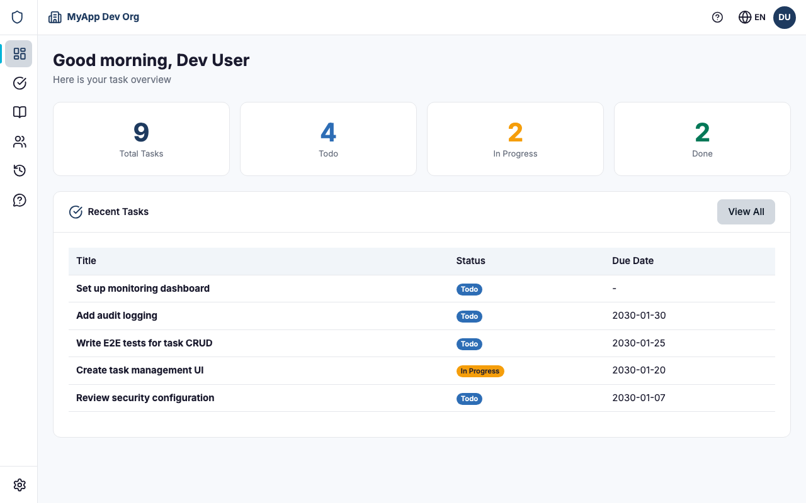
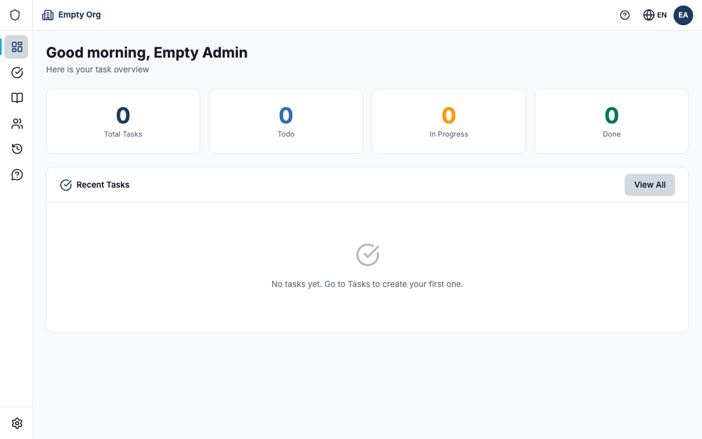
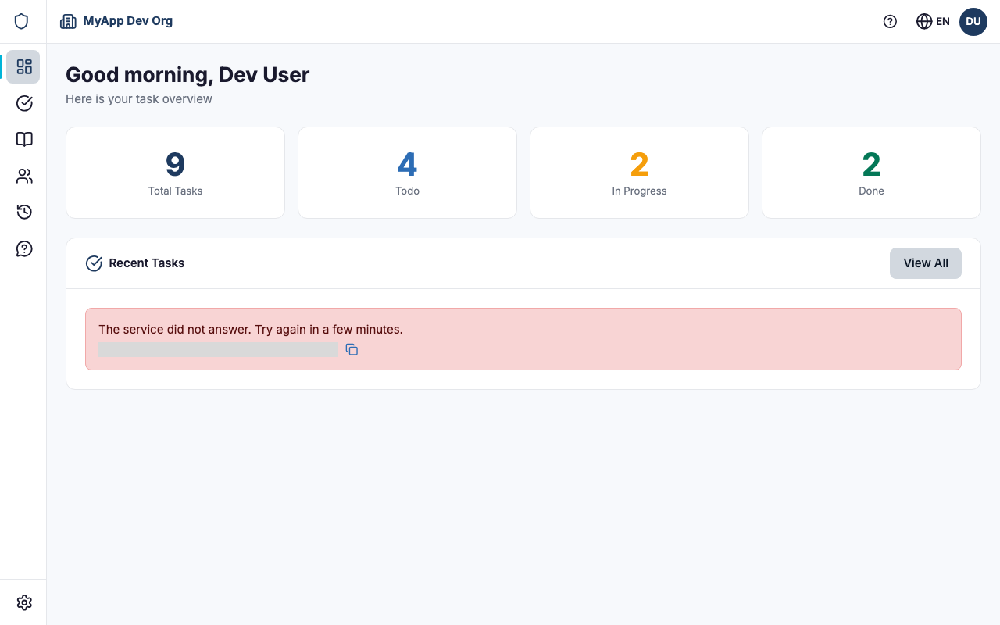

# See my latest tasks

See the most recently created tasks on the dashboard, to review what needs attention without opening the task list.

## Steps

1. In the menu, click "Dashboard".
2. Read the "Recent Tasks" section under the four cards.

   

## What you will see

- A table with the columns "Title", "Status" and "Due Date".
- The status as a colored label: "Todo", "In Progress", "Done" or "Cancelled".
- A task without a due date shows "-".
- At most five tasks, the most recently created first.
- When there are no tasks, Admins and Editors read "No tasks yet. Go to Tasks to create your first one." and Viewers read "No tasks yet", instead of the table.

## Good to know

- The five tasks are the newest among all the tasks of the organization, whatever their status.
- You cannot choose how many tasks to show, and you cannot change a task from the dashboard.

## If something goes wrong

| What you see | What to do |
|---|---|
| "The service did not answer. Try again in a few minutes." | Reload the page later. |

## Related pages

- [See my task counts](US-DASH-01.md)
- [Open the task list from the dashboard](US-DASH-03.md)
- [Read a greeting on the dashboard](US-DASH-04.md)
