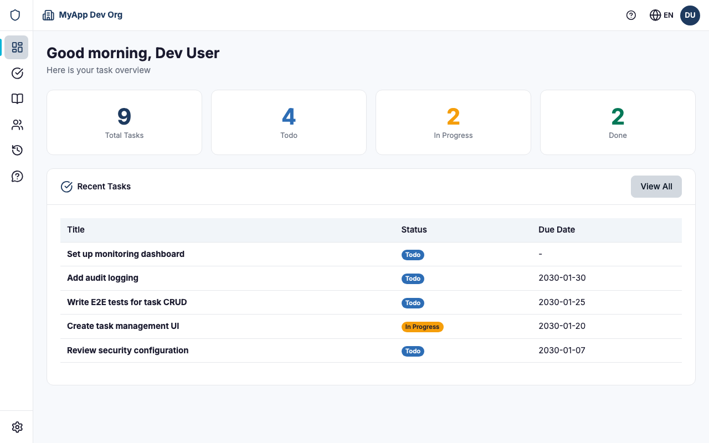

# Read a greeting on the dashboard

Be greeted by name when you open the dashboard, so the page feels personal and you know it is up to date.

## Steps

1. In the menu, click "Dashboard".

   

## What you will see

- A greeting followed by a comma and your name: "Good morning" before 12:00, "Good afternoon" from 12:00 to 17:59 and "Good evening" from 18:00.
- Under it, the line "Here is your task overview".
- If the application does not know your name, only the greeting is shown.
- If you use the application in Italian, both lines are in Italian.

## Good to know

- The time of day is the time on your own device, not the time of the organization.
- The greeting text is fixed: it cannot be changed and it does not change on holidays.

## Related pages

- [See my task counts](US-DASH-01.md)
- [See my latest tasks](US-DASH-02.md)
- [Open the task list from the dashboard](US-DASH-03.md)
