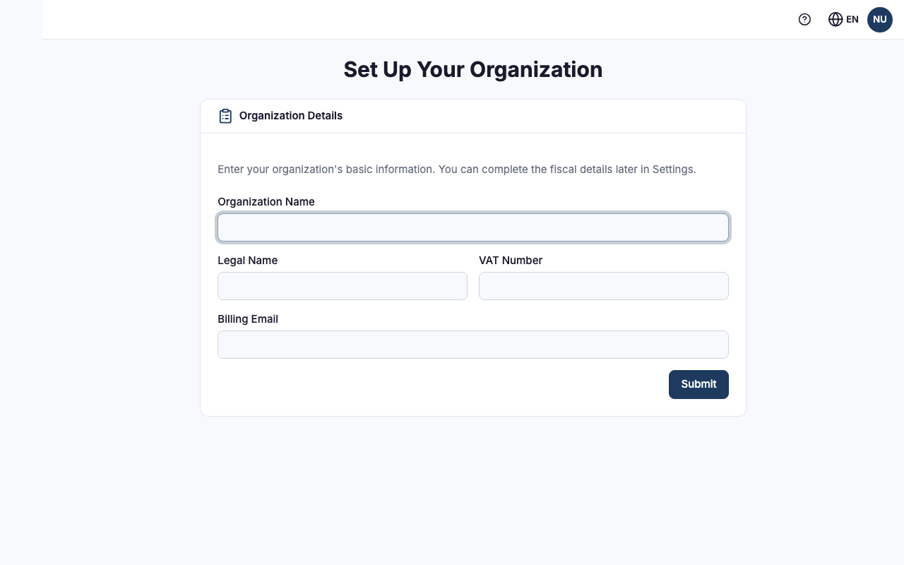

# Get asked to set up an organization

If you belong to no organization yet, the app guides you to set one up before you start working.

## Steps

1. Open the address of the app in your browser and sign in.
2. The "Set Up Your Organization" page opens, whichever page you tried to open. It has one step, "Organization Details", and a "Submit" button.

   

## What you will see

- The "Set Up Your Organization" page is shown in your language, English or Italian.
- There is no way to skip it: without an organization there is nothing else to use.

## Good to know

- The page is shown as long as, and only while, you belong to no organization.
- If you belong to at least one organization, you never see it. This includes invited people the first time they sign in, which is why your colleagues may not see this page.
- The page does not let you choose a language or invite team members. To change the language, use the "Change language" button in the header.

## Related pages

- [Create my organization in the wizard](US-ONBOARD-02.md)
