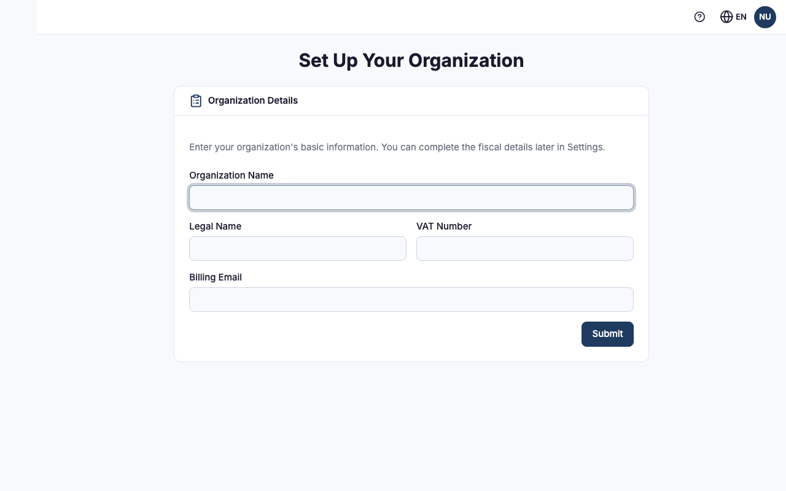
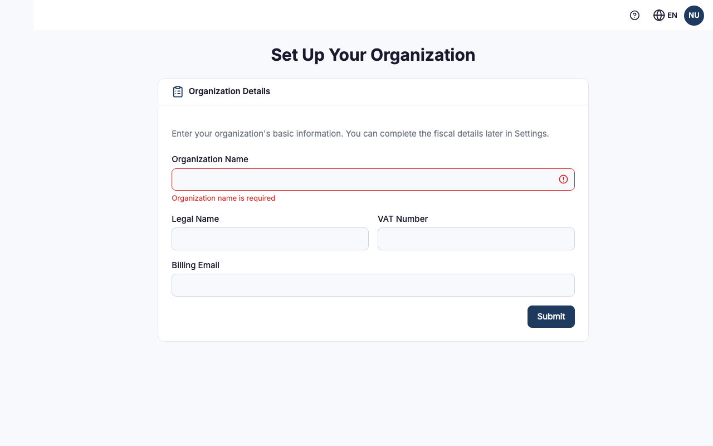
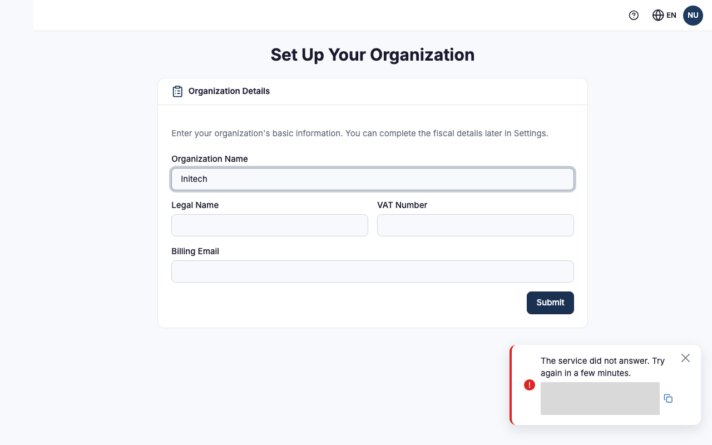

# Create my organization in the wizard

Enter the basic details of your organization in the wizard to get an organization to work in.

## Before you start

- You belong to no organization yet, so the "Set Up Your Organization" page is open.

## Steps

1. Type the name of your organization in "Organization Name". This is the only required field.

   

2. If you want, fill in "Legal Name", "VAT Number" and "Billing Email".
3. Click "Submit". If "Organization Name" is empty, the message "Organization name is required" appears and nothing is created.

   

4. While the organization is created the page reads "Creating your organization...".
5. The message "Organization created successfully!" appears and the Dashboard page of the new organization opens.

## What you will see

- The header shows the name of your new organization.
- You are the Admin of the new organization and you see "Settings" in the menu.

## Good to know

- A name made only of spaces counts as empty.
- If you leave "Legal Name" empty, it is filled in with the organization name. The country starts as "IT".
- The other fiscal and billing details are completed later in Settings.
- The wizard does not ask for an industry, a template, a language or a fiscal year, and it cannot create a second organization: it is only for people who have none.

## If something goes wrong

| What you see | What to do |
|---|---|
| "Organization name is required" | Type a name that is not only spaces in "Organization Name", then click "Submit" again. |
| "The service did not answer. Try again in a few minutes." | Click "Submit" again later. The wizard keeps what you typed. |

## Related pages

- [Get asked to set up an organization](US-ONBOARD-01.md)
