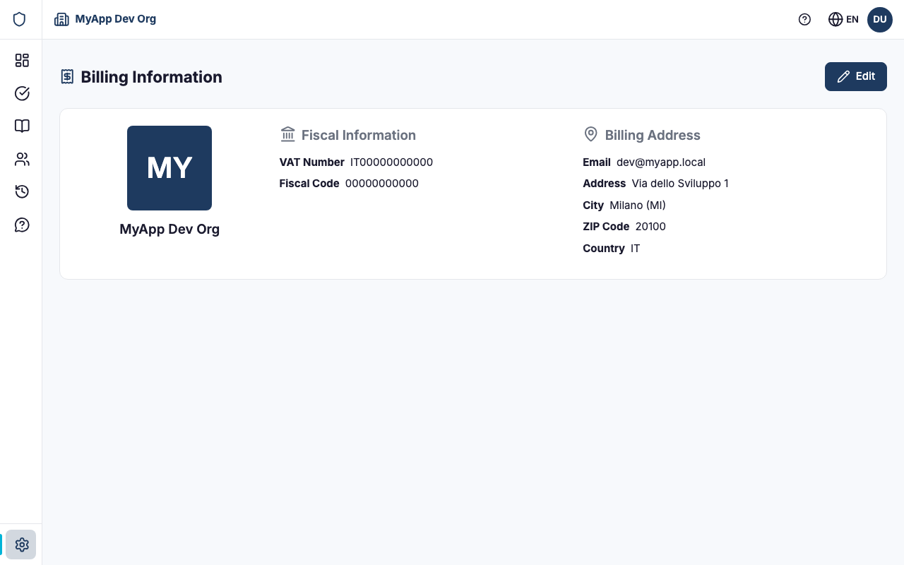
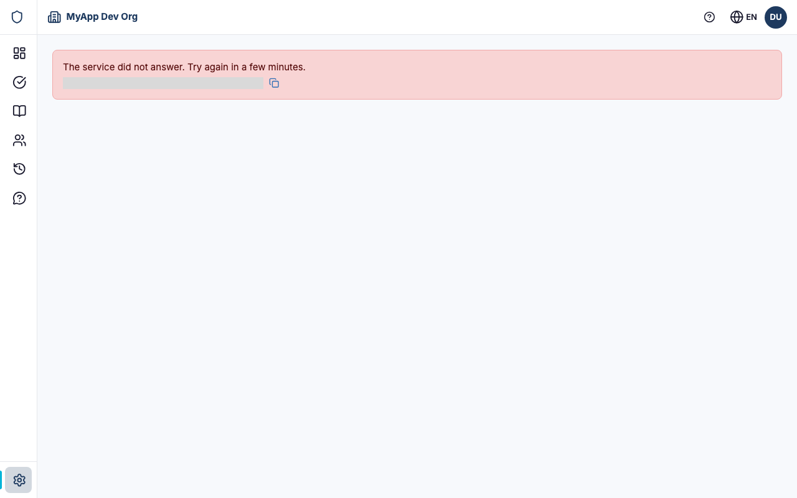

# See the organization details

Check the profile and billing details of your organization, so you know the company data is correct.

## Before you start

- Only Admins can do this. Editors and Viewers do not see "Settings"; if they open the page by its address, they are taken to the Dashboard with the message "You don't have access to this page."

## Steps

1. In the menu, click "Settings".

   

## What you will see

- The page "Billing Information", with the logo (or the first two letters of the name when there is no logo) and the organization name.
- Under "Fiscal Information": "VAT Number" and "Fiscal Code".
- Under "Billing Address": "Email", "Address", "City" with the province in brackets, "ZIP Code" and "Country".
- A detail that has not been filled in shows "-".
- The "Edit" button, which opens the page where you change the details.

## Good to know

- The page shows the organization currently selected in the header.
- You cannot delete the organization here, see its members (the Team page does that) or manage billing plans and invoices.

## If something goes wrong

| What you see | What to do |
|---|---|
| "The service did not answer. Try again in a few minutes." | Reload the page later. |

## Related pages

- [Edit the organization details](US-ORG-02.md)
- [Upload the organization logo](US-ORG-03.md)
- [See the team members](US-ORG-04.md)
- [Invite a team member](US-ORG-05.md)
- [Change the role of a team member](US-ORG-06.md)
- [Remove a team member](US-ORG-07.md)
