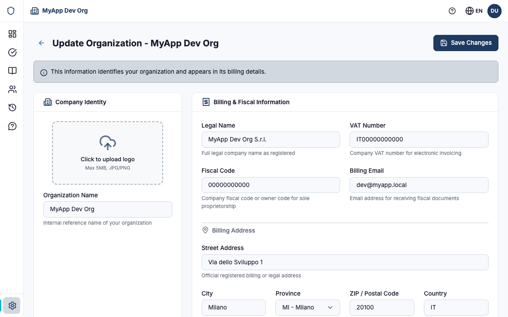
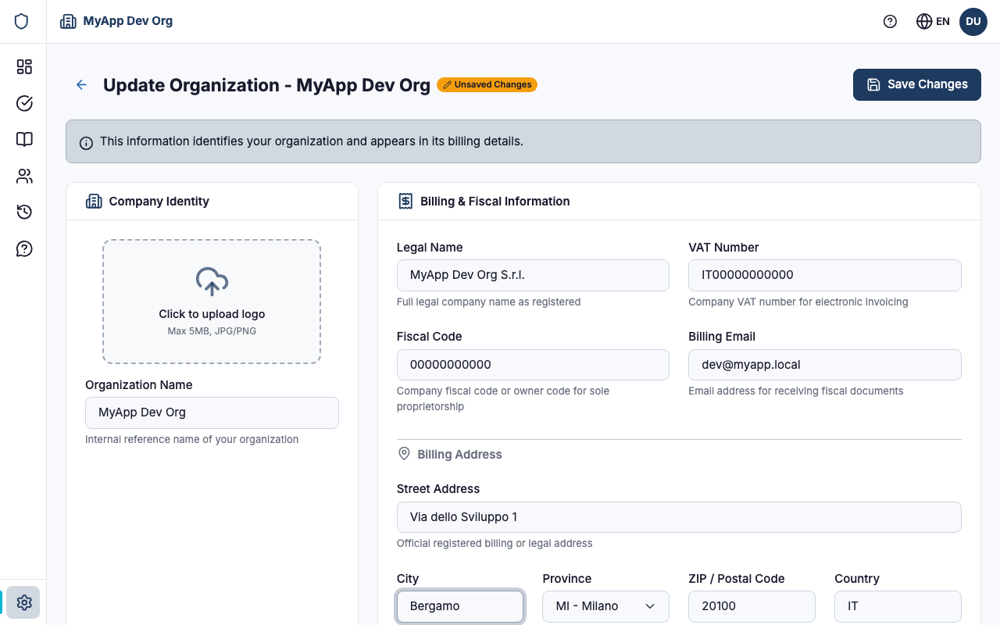
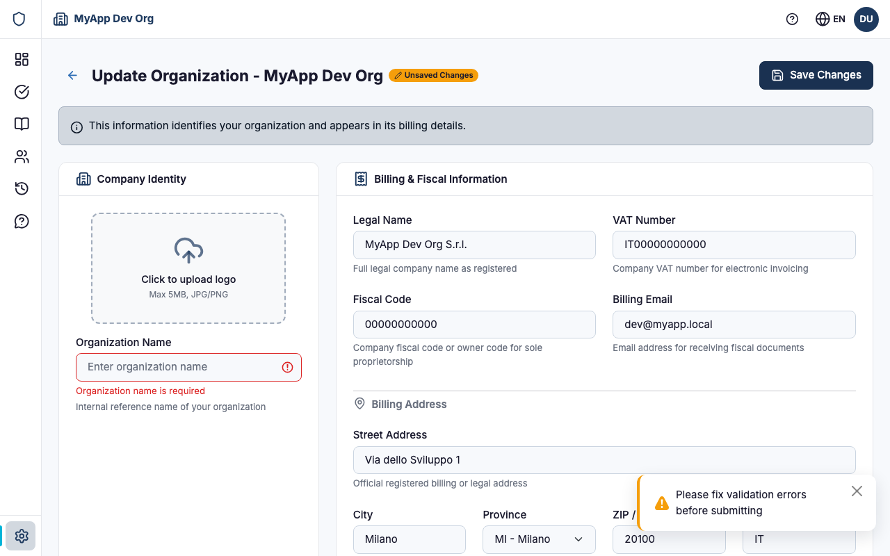
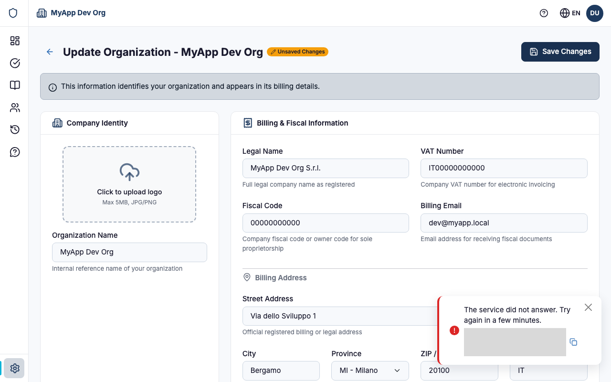

# Edit the organization details

Change the name and the billing details of your organization, so contracts and invoices carry the correct company data.

## Before you start

- Only Admins can do this.

## Steps

1. In the menu, click "Settings".
2. Click "Edit". The "Update Organization" page opens with the current values.

   
3. Change what you need. Every field is required: "Organization Name", "Legal Name", "VAT Number", "Fiscal Code", "Billing Email", "Street Address", "City", "Province", "ZIP / Postal Code" and "Country".

   
4. Click "Save Changes".

## What you will see

- The message "Organization has been updated successfully".
- The Organization page opens with the new values.
- While the values differ from the saved ones, the badge "Unsaved Changes" is shown next to the page title.

## Good to know

- The back arrow returns to the Organization page without saving.
- The application does not check that the VAT number or the fiscal code really exist, and there are no industry templates.

## If something goes wrong

| What you see | What to do |
|---|---|
| "Organization name is required" | Fill in the field under which the message appears. Other required fields show a similar message, such as "Legal name is required". |
| "Please fix validation errors before submitting" | Correct the fields marked in red, then click "Save Changes" again. |
| "Invalid email format" | Type a valid email address in "Billing Email". |
| "ZIP code must be 5 digits" | Type exactly five digits in "ZIP / Postal Code". |
| "The service did not answer. Try again in a few minutes." | Click "Save Changes" again later. The page keeps the values you typed. |

## Related pages

- [See the organization details](US-ORG-01.md)
- [Upload the organization logo](US-ORG-03.md)
- [See the team members](US-ORG-04.md)
- [Invite a team member](US-ORG-05.md)
- [Change the role of a team member](US-ORG-06.md)
- [Remove a team member](US-ORG-07.md)
