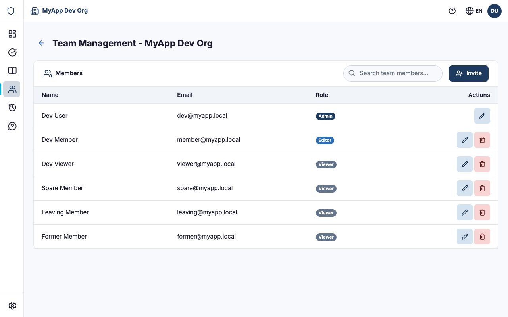
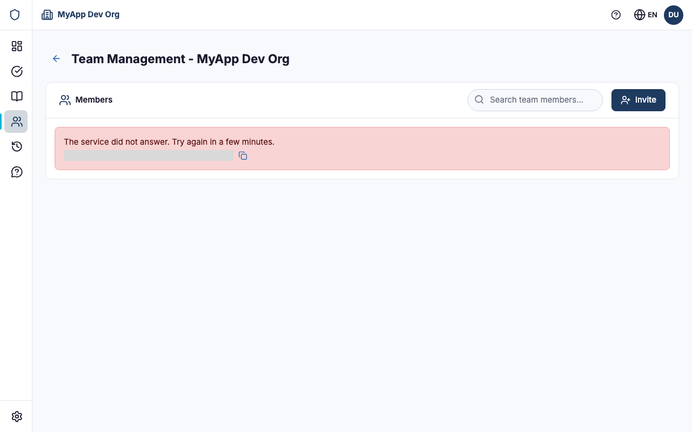

# See the team members

See who belongs to your organization and with which role, so you know who can do what.

## Before you start

- Only Admins can do this. Editors and Viewers do not see "Team"; if they open the page by its address, they are taken to the Dashboard with the message "You don't have access to this page."

## Steps

1. In the menu, click "Team".

   
2. To find someone, type part of a name or an email in "Search team members...".

## What you will see

- The page "Team Management" followed by the name of the organization.
- The "Members" table with the name, email and role ("Admin", "Editor" or "Viewer") of each member.
- Under "Pending Invitations", the people who were invited and have not signed in yet, with name, email and the date sent.
- When nothing matches your search, the table reads "No team members match your search".
- The back arrow opens the Organization page.

## Good to know

- The search ignores upper and lower case.
- "Members" lists only people who have joined; invited people appear only under "Pending Invitations".
- You cannot sort the table, show it in pages, or resend or cancel an invitation.

## If something goes wrong

| What you see | What to do |
|---|---|
| "The service did not answer. Try again in a few minutes." | Reload the page later. |

## Related pages

- [See the organization details](US-ORG-01.md)
- [Edit the organization details](US-ORG-02.md)
- [Upload the organization logo](US-ORG-03.md)
- [Invite a team member](US-ORG-05.md)
- [Change the role of a team member](US-ORG-06.md)
- [Remove a team member](US-ORG-07.md)
