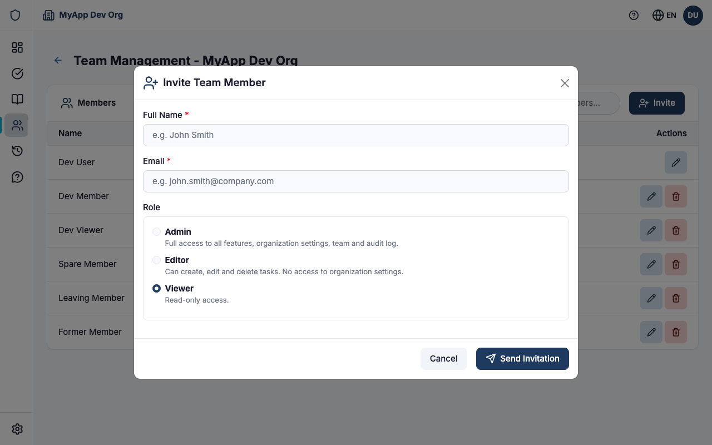

# Invite a team member

Invite a colleague by email and give them a role, so they can work in your organization.

## Before you start

- Only Admins can do this.

## Steps

1. In the menu, click "Team".
2. Click "Invite". The "Invite Team Member" dialog opens.

   
3. In "Full Name", type the name of the person.
4. In "Email", type their email address.
5. Choose the role: "Admin", "Editor" or "Viewer". Each one has a short description.
6. Click "Send Invitation".

## What you will see

- The dialog closes and the message "Invitation sent successfully" appears.
- The person is listed under "Pending Invitations".

## Good to know

- "Viewer" is selected when the dialog opens.
- The person stays under "Pending Invitations", not under "Members", until they sign in.
- If you click "Cancel", the dialog closes and nobody is invited.
- You can invite one person at a time, and you cannot resend or cancel an invitation.

## If something goes wrong

| What you see | What to do |
|---|---|
| "Full name is required" | Type the name in "Full Name". |
| "Email address is required" | Type the address in "Email". |
| "Please enter a valid email address" | Check the address and type it in full, for example name@company.com. |
| "User is already a member of this organization." | Use another email, or change the role of that member. |
| "A pending invitation for this email already exists." | Wait for the person to sign in; no second invitation is needed. |

## Related pages

- [See the organization details](US-ORG-01.md)
- [Edit the organization details](US-ORG-02.md)
- [Upload the organization logo](US-ORG-03.md)
- [See the team members](US-ORG-04.md)
- [Change the role of a team member](US-ORG-06.md)
- [Remove a team member](US-ORG-07.md)
