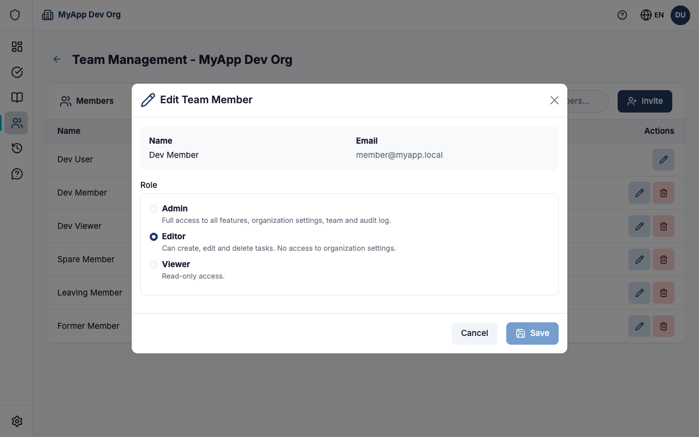

# Change the role of a team member

Give a member a different role, so each person has the right level of access.

## Before you start

- Only Admins can do this.

## Steps

1. In the menu, click "Team".
2. On the row of the member, click the "Edit" button (the pencil). The "Edit Team Member" dialog opens.

   
3. Choose another role: "Admin", "Editor" or "Viewer".
4. Click "Save".

## What you will see

- The dialog closes and the message "Member updated successfully" appears.
- The row of the member shows the new role.

## Good to know

- "Save" stays disabled until you choose a different role. The name and the email are shown but cannot be changed.
- If you click "Cancel", the dialog closes and nothing changes.
- If you lower your own role, the dialog warns "You are removing your own Admin privileges. This action cannot be undone by yourself." and asks you to confirm: "Save" is replaced by "Go Back" and "Confirm Demotion".
- An organization always keeps at least one Admin.
- You cannot change several members at once.

## If something goes wrong

| What you see | What to do |
|---|---|
| "An organization needs at least one Admin." | Give another member the Admin role first. |
| "This member is no longer in the team." | Another Admin removed them. Continue with the updated table, where the member is no longer shown. |

## Related pages

- [See the organization details](US-ORG-01.md)
- [Edit the organization details](US-ORG-02.md)
- [Upload the organization logo](US-ORG-03.md)
- [See the team members](US-ORG-04.md)
- [Invite a team member](US-ORG-05.md)
- [Remove a team member](US-ORG-07.md)
