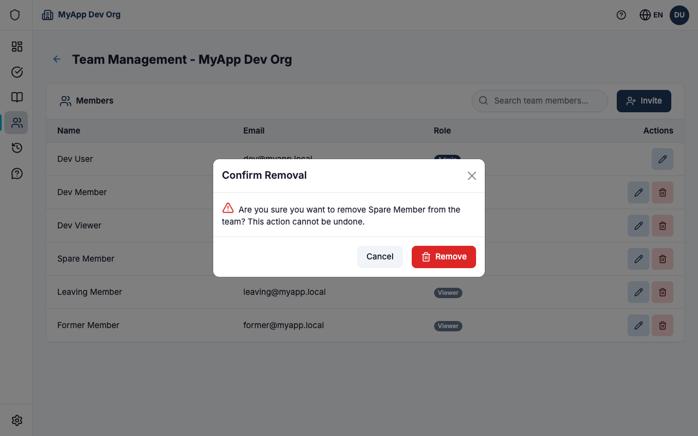

# Remove a team member

Take a person out of your organization, so people who left no longer have access.

## Before you start

- Only Admins can do this.
- Admins have no "Remove" button. To remove an Admin, lower their role first.

## Steps

1. In the menu, click "Team".
2. On the row of the member, click "Remove". The "Confirm Removal" dialog opens.

   
3. Click "Remove" in the dialog to confirm, or "Cancel" to keep the member.

## What you will see

- The dialog asks "Are you sure you want to remove" followed by the name and "from the team? This action cannot be undone."
- After you confirm, the dialog closes and the message "Member removed successfully" appears.
- The member is no longer in the "Members" table.

## Good to know

- Removing a member cannot be undone. To let the person in again, invite them again.
- You cannot cancel a pending invitation here.

## If something goes wrong

| What you see | What to do |
|---|---|
| "This member is no longer in the team." | Another Admin removed them first. Continue with the updated table, where the member is no longer shown. |

## Related pages

- [See the organization details](US-ORG-01.md)
- [Edit the organization details](US-ORG-02.md)
- [Upload the organization logo](US-ORG-03.md)
- [See the team members](US-ORG-04.md)
- [Invite a team member](US-ORG-05.md)
- [Change the role of a team member](US-ORG-06.md)
