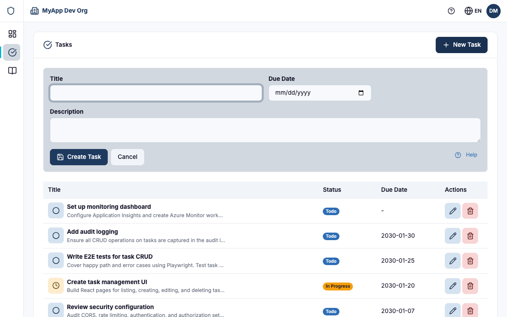
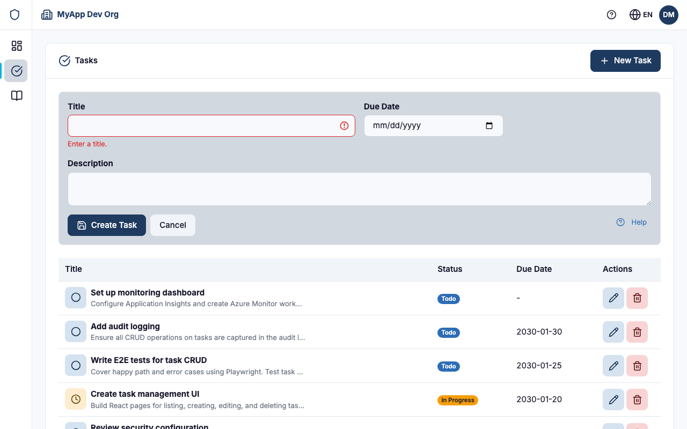
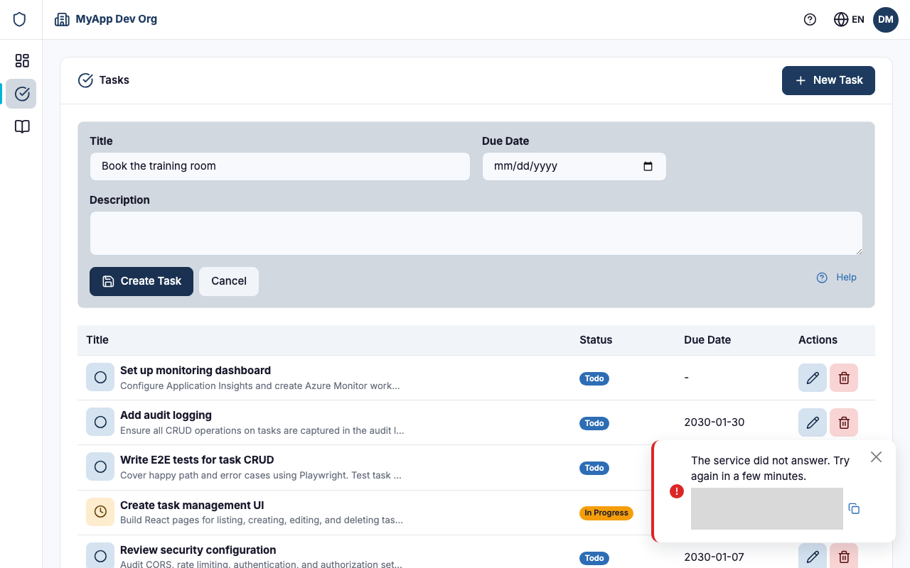

# Create a task

Add a task with a title so the team can see what needs to be done. You can also set a due date and a description.

## Before you start

- Only Admins and Editors can create tasks. Viewers do not see the "New Task" button.

## Steps

1. In the menu, click "Tasks".
2. Click "New Task". A form opens above the list.

   
3. In the "Title" field, type the name of the task. This is the only required field.
4. If you want, choose a date in "Due Date" and add details in "Description".
5. Click "Create Task".

## What you will see

- The form closes.
- The new task is the first row of the list, with its description under the title, its due date and the status "Todo".

## Good to know

- A new task always starts as "Todo".
- A title made only of spaces counts as empty.
- The title can have up to 200 characters and the description up to 2000; anything more is ignored as you type.
- If you click "Cancel", the form closes and no task is added.
- A task cannot be assigned to a person, several tasks cannot be created at once and files cannot be attached.

## If something goes wrong

| What you see | What to do |
|---|---|
| "Enter a title." | Type a title in the "Title" field, then click "Create Task" again. |
| "Your role does not allow this change." | Your role was changed to Viewer while the form was open. Ask an admin of the organization for the Editor role. |
| "The service did not answer. Try again in a few minutes." | Click "Create Task" again later. The form keeps what you typed. |

## Related pages

- [Edit a task](US-TASK-02.md)
- [Change the status of a task](US-TASK-03.md)
- [Delete a task](US-TASK-04.md)
- [See the list of tasks](US-TASK-05.md)
