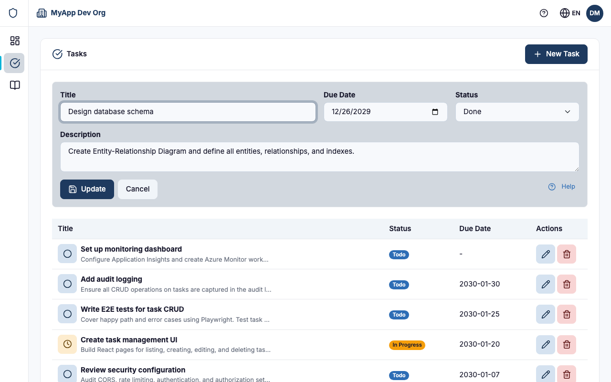

# Edit a task

Change the title, due date, status or description of a task, so the list stays correct when plans change.

## Before you start

- Only Admins and Editors can edit tasks. Viewers do not see the "Edit" button.

## Steps

1. In the menu, click "Tasks".
2. On the row of the task, click the "Edit" button (the pencil). A form opens above the list with the values of that task.

   
3. Change what you need in "Title", "Due Date", "Status" or "Description". The status can be "Todo", "In Progress", "Done" or "Cancelled".
4. Click "Update".

## What you will see

- The form closes.
- The row shows the new values, and the title is the one you typed.

## Good to know

- Only what you changed is updated; every other detail of the task stays as it was.
- The status you choose in the form is the status shown on the row.
- If you click "Cancel", the form closes and the task keeps its previous values.
- You cannot change who a task is assigned to or edit several tasks at once.
- The history of the changes of a task is in the Audit Log, which only Admins can open.

## If something goes wrong

| What you see | What to do |
|---|---|
| "Enter a title." | Type a title in the "Title" field, then click "Update" again. |
| "This task no longer exists." | Another member deleted it. Continue with the updated list, where the task is no longer shown. |
| "Your role does not allow this change." | Your role was changed to Viewer while the form was open. Ask an admin of the organization for the Editor role. |

## Related pages

- [Create a task](US-TASK-01.md)
- [Change the status of a task](US-TASK-03.md)
- [Delete a task](US-TASK-04.md)
- [See the list of tasks](US-TASK-05.md)
