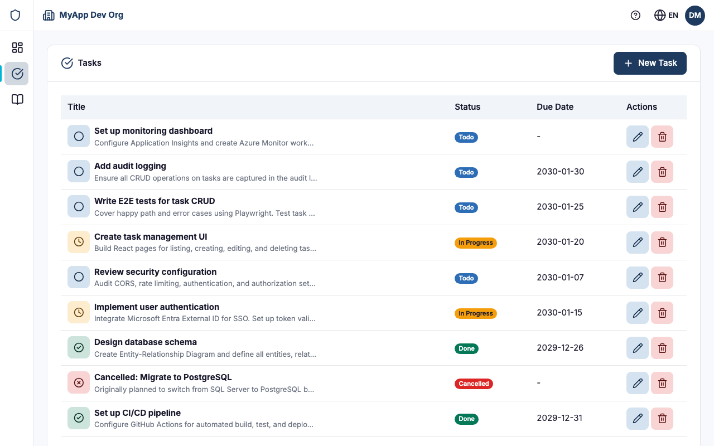

# Change the status of a task

Move a task forward with one click, so everyone sees how far the work has come.

## Before you start

- Only Admins and Editors can do this. Viewers see the status but not the "Change status" button.

## Steps

1. In the menu, click "Tasks".
2. At the start of the row of the task, click the "Change status" button (the round icon).

   
3. Click it again to move the task on to the next status.

## What you will see

- The status on the row changes at once, without leaving the page.
- The title, description and due date stay the same.

## Good to know

- The order is "Todo", "In Progress", "Done", and then "Todo" again.
- A task that is "Cancelled" goes back to "Todo", never straight to "In Progress" or "Done".
- The button cannot cancel a task and cannot jump to a status you choose. To do that, use the edit form.

## If something goes wrong

| What you see | What to do |
|---|---|
| "This task no longer exists." | Another member deleted it. Continue with the updated list, where the task is no longer shown. |

## Related pages

- [Create a task](US-TASK-01.md)
- [Edit a task](US-TASK-02.md)
- [Delete a task](US-TASK-04.md)
- [See the list of tasks](US-TASK-05.md)
