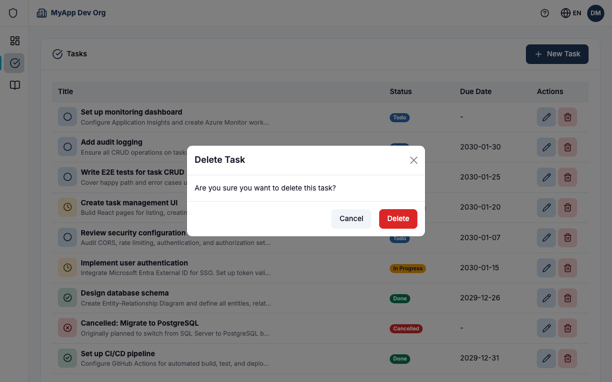

# Delete a task

Remove a task you no longer need, so the list only shows work that matters.

## Before you start

- Only Admins and Editors can delete tasks. Viewers do not see the "Delete" button.

## Steps

1. In the menu, click "Tasks".
2. On the row of the task, click the "Delete" button (the bin). The "Delete Task" dialog asks "Are you sure you want to delete this task?"

   
3. Click "Delete" in the dialog to confirm, or "Cancel" to keep the task.

## What you will see

- The dialog closes and the task is no longer in the list.
- If it was the last task, the page shows "No tasks yet".

## Good to know

- A deleted task cannot be restored.
- Tasks are deleted one at a time.

## If something goes wrong

| What you see | What to do |
|---|---|
| "This task no longer exists." | Another member deleted it first. Continue with the updated list, where the task is no longer shown. |

## Related pages

- [Create a task](US-TASK-01.md)
- [Edit a task](US-TASK-02.md)
- [Change the status of a task](US-TASK-03.md)
- [See the list of tasks](US-TASK-05.md)
