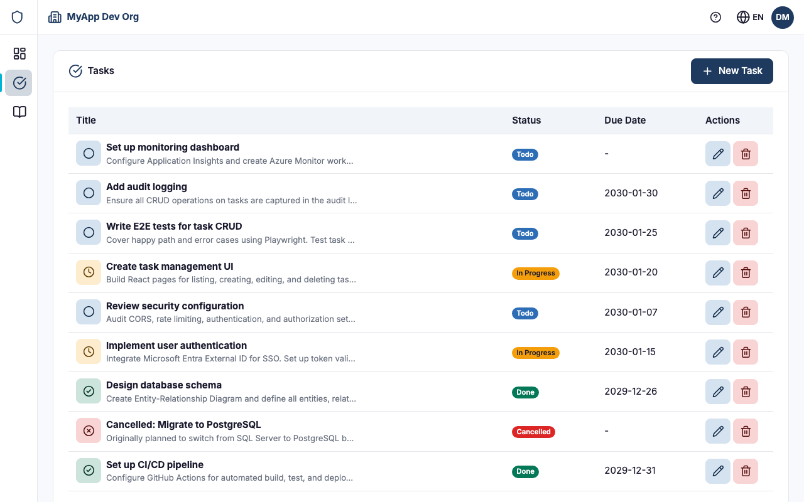
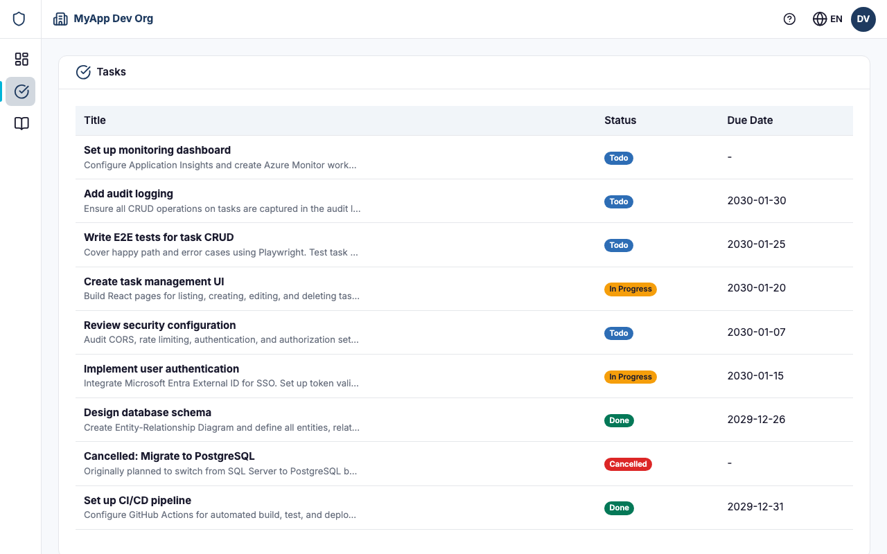
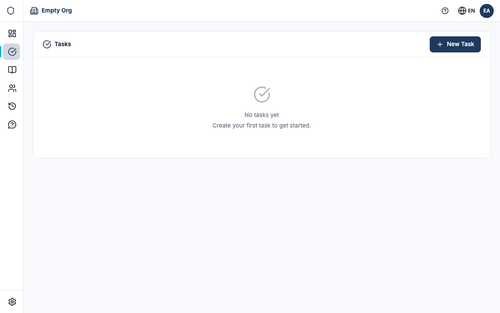
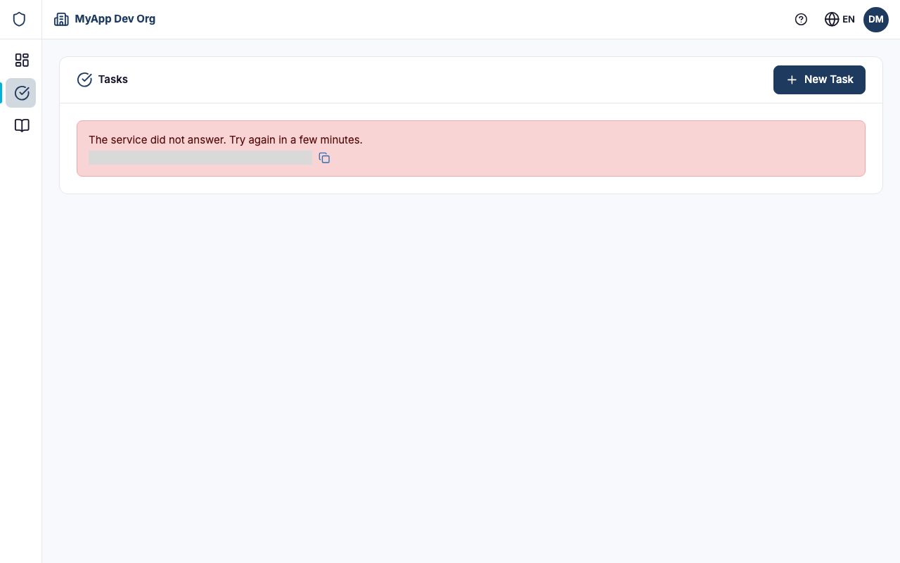

# See the list of tasks

See all the tasks of your organization, so you know what the team is working on.

## Steps

1. In the menu, click "Tasks".

   

## What you will see

- A table with the columns "Title", "Status" and "Due Date". Admins and Editors also see "Actions".
- Each row shows the title, the description in smaller text below it and the status as a colored label.
- A task without a due date shows "-".
- While the tasks load, a spinner is shown instead of the table.
- When there are no tasks, the page reads "No tasks yet". Admins and Editors also read "Create your first task to get started."

## Good to know

- The newest task is at the top of the list.
- The list shows the 50 newest tasks of the current organization only; there is no search, filter or paging.
- Viewers can read the list but do not see the buttons to create, edit, change the status of or delete tasks.
- The list does not show who a task is assigned to.

## If something goes wrong

| What you see | What to do |
|---|---|
| "The service did not answer. Try again in a few minutes." | Reload the page later. |

## Related pages

- [Create a task](US-TASK-01.md)
- [Edit a task](US-TASK-02.md)
- [Change the status of a task](US-TASK-03.md)
- [Delete a task](US-TASK-04.md)
