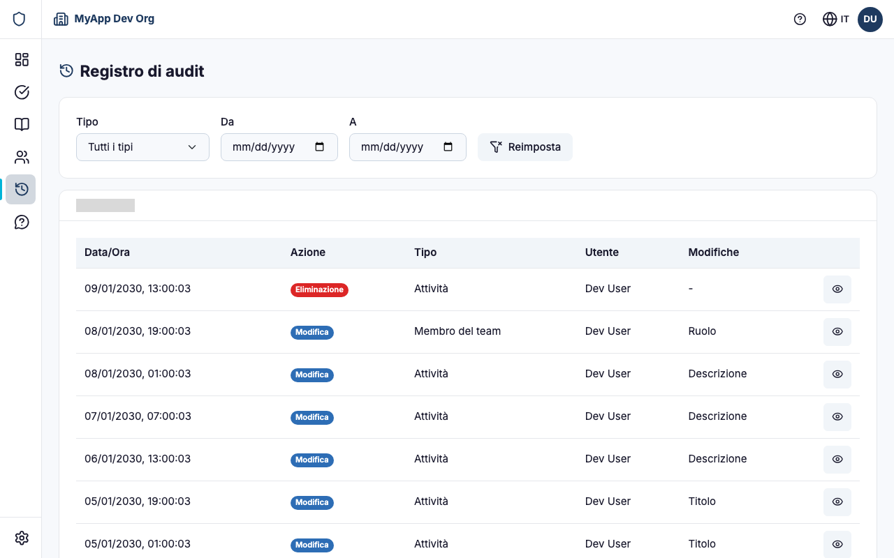
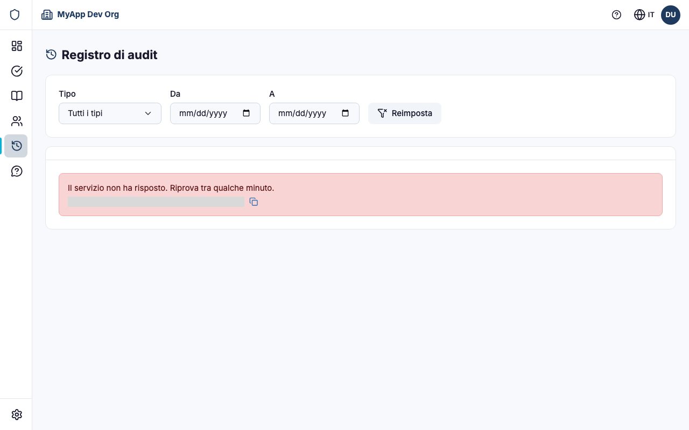

# Aprire il registro di audit

Leggi l'elenco delle modifiche fatte nella tua organizzazione, per vedere chi ha cambiato cosa e quando.

## Prima di iniziare

- Solo gli Admin possono aprire il registro di audit. Gli Editor e i Visualizzatori non vedono il link "Registro di audit"; se aprono la pagina dal suo indirizzo, vengono portati alla Dashboard con il messaggio "Non hai accesso a questa pagina."

## Passaggi

1. Nel menu, fai clic su "Registro di audit".

   

## Cosa vedrai

- Una tabella con le colonne "Data/Ora", "Azione", "Tipo", "Utente" e "Modifiche". Il tipo è "Attività", "Membro del team", "Organizzazione" o "Utente".
- In cima la modifica più recente e sopra la tabella il numero totale di modifiche elencate.
- 25 modifiche per pagina. "Precedente" e "Successivo" cambiano pagina e la posizione è indicata come "1 / 3".
- L'azione è "Creazione", "Modifica" o "Eliminazione", con il nome di chi ha fatto la modifica.
- Per una "Modifica", la colonna "Modifiche" elenca i campi cambiati, per esempio "Titolo". Per "Creazione" ed "Eliminazione" mostra "-".
- Gli orari sono nel fuso orario del tuo dispositivo.
- Quando non ci sono ancora modifiche, la tabella dice "Nessuna modifica trovata."

## Da sapere

- Sono elencate solo le modifiche dell'organizzazione selezionata, e solo quelle dell'ultimo anno.
- Vengono registrate la creazione, la modifica e l'eliminazione dell'organizzazione, dei suoi membri, delle sue attività e dei suoi utenti.
- Nessuno può modificare o cancellare una modifica registrata.
- Non si può esportare, stampare o annullare una modifica, e il registro non tiene traccia di chi ha aperto o letto i dati.

## Se qualcosa non va

| Cosa vedi | Cosa fare |
|---|---|
| "Il servizio non ha risposto. Riprova tra qualche minuto." | Ricarica la pagina più tardi. |

## Pagine correlate

- [Filtrare il registro di audit](US-AUD-02.md)
- [Vedere cosa è cambiato in una voce](US-AUD-03.md)
