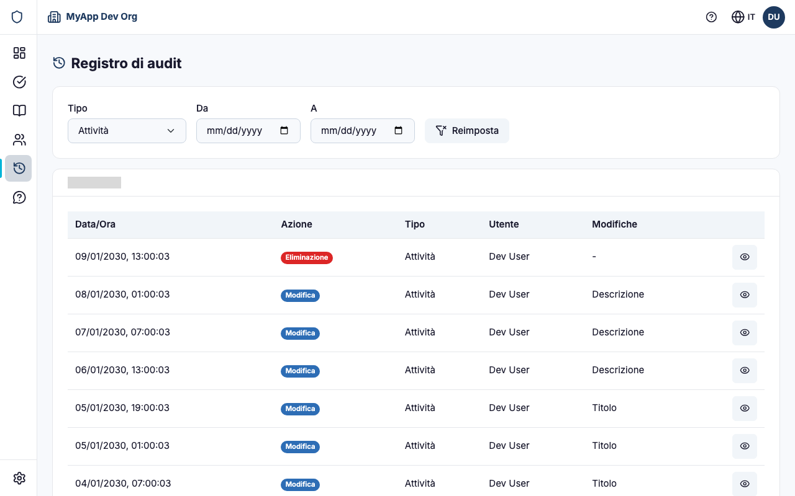

# Filtrare il registro di audit

Restringi l'elenco delle modifiche per tipo e per data, per trovare subito una modifica precisa.

## Prima di iniziare

- Solo gli Admin possono aprire il registro di audit.

## Passaggi

1. Nel menu, fai clic su "Registro di audit".
2. Nel campo "Tipo" scegli un tipo, per esempio "Attività".

   
3. Per guardare un periodo, scegli le date in "Da" e "A".
4. Per vedere di nuovo tutto, fai clic su "Reimposta".

## Cosa vedrai

- Solo le modifiche del tipo scelto e un numero più basso sopra la tabella.
- Con le date, solo le modifiche fatte dall'inizio del primo giorno alla fine dell'ultimo, secondo l'ora del tuo dispositivo.
- Con tipo e date insieme, solo le modifiche che rispettano tutti i filtri.
- Ogni volta che cambi un filtro, torna la prima pagina del risultato.
- Quando nulla corrisponde, la tabella dice "Nessuna modifica trovata."

## Da sapere

- Il campo "Tipo" parte da "Tutti i tipi" e offre sempre "Attività", "Membro del team", "Organizzazione" e "Utente", qualunque cosa sia elencata.
- I filtri cercano in tutta la cronologia dell'organizzazione, non solo nella pagina che stai guardando.
- Non si può filtrare per utente, cercare per testo o salvare un filtro per dopo.

## Pagine correlate

- [Aprire il registro di audit](US-AUD-01.md)
- [Vedere cosa è cambiato in una voce](US-AUD-03.md)
