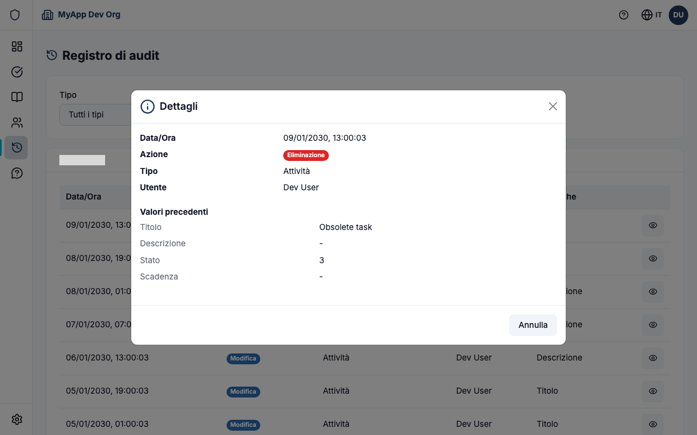

# Vedere cosa è cambiato in una voce

Apri una modifica e guarda i valori prima e dopo, per capire esattamente cosa è stato cambiato.

## Prima di iniziare

- Solo gli Admin possono aprire il registro di audit.

## Passaggi

1. Nel menu, fai clic su "Registro di audit".
2. Sulla riga della modifica fai clic sul pulsante "Dettagli" (l'occhio). Si apre il dialogo "Dettagli".

   
3. Leggi il dialogo, poi fai clic su "Annulla" per chiuderlo.

## Cosa vedrai

- "Data/Ora", "Azione", "Tipo" e "Utente" della modifica.
- Per una "Modifica", "Valori precedenti" e "Nuovi valori" con solo i campi cambiati, per esempio "Titolo".
- Per una "Creazione", solo "Nuovi valori", con i dati inseriti.
- Per una "Eliminazione", solo "Valori precedenti", con i dati rimossi.
- Campi e valori hanno gli stessi nomi delle schermate in cui si modificano, per esempio lo stato "In corso".
- Dopo la chiusura del dialogo, l'elenco è come l'avevi lasciato.

## Da sapere

- I valori precedenti esistono solo per modifiche ed eliminazioni; i nuovi valori solo per creazioni e modifiche.
- Non si possono ripristinare i valori precedenti né confrontare due voci affiancate.

## Pagine correlate

- [Aprire il registro di audit](US-AUD-01.md)
- [Filtrare il registro di audit](US-AUD-02.md)
