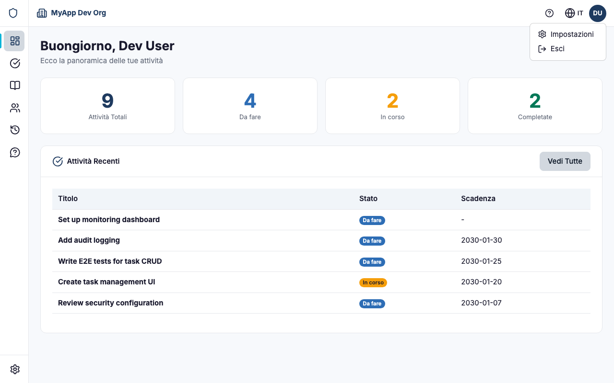
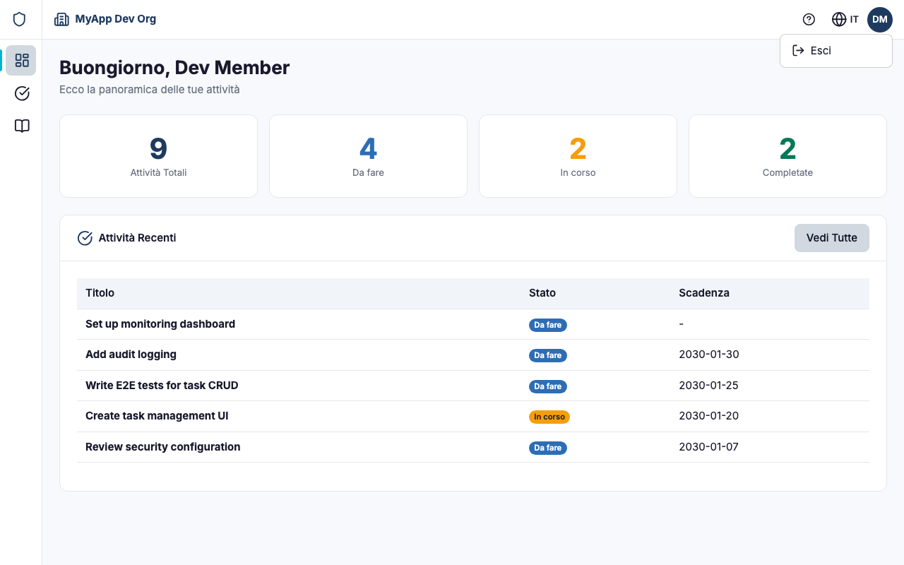

# Uscire dall'app

Esci quando hai finito, così nessun altro può usare il tuo account su questo dispositivo.

## Passaggi

1. Clicca il pulsante rotondo con le tue iniziali in alto a destra, in qualsiasi pagina. Si apre un menu.

   

2. Clicca "Esci". Se non sei un amministratore, il menu offre solo questa voce.

   

3. Si apre la pagina di accesso.

## Cosa vedrai

- Si apre la pagina di accesso.
- Aprendo qualsiasi pagina dell'app ti viene chiesto di accedere di nuovo.

## Da sapere

- L'uscita termina la sessione solo su questo dispositivo: non ti disconnette dagli altri.
- Uscire non elimina il tuo account né i dati della tua organizzazione.
- L'app non chiede conferma prima di farti uscire.
- Gli amministratori trovano in questo menu anche "Impostazioni".

## Pagine correlate

- [Accedere con il tuo indirizzo email](US-AUTH-01.md)
- [Accedere prima di usare l'app](US-AUTH-02.md)
