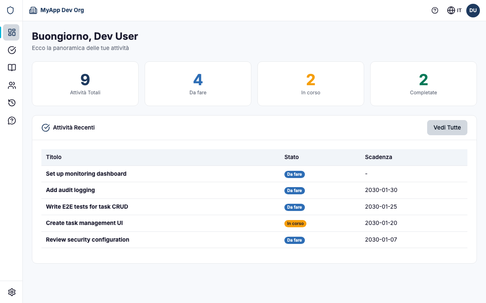
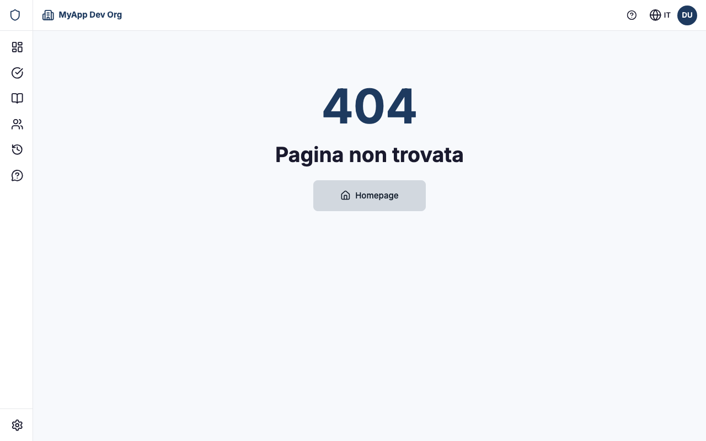

# Spostarsi tra le sezioni dell'app

Usa il menu a sinistra per raggiungere le sezioni dell'app. L'intestazione mostra l'organizzazione in cui stai lavorando.

## Passaggi

1. Accedi. Arrivi nella pagina "Dashboard".
2. Guarda il menu a sinistra. Elenca "Dashboard" e "Attività"; gli amministratori vedono anche "Team" e "Registro di audit", e "Impostazioni" in fondo.

   

3. Clicca una voce per aprire la sua pagina. La voce della pagina aperta è evidenziata.
4. Se fai parte di più organizzazioni, clicca il nome di quella attuale nell'intestazione e scegline un'altra. Ogni pagina mostra poi i dati dell'organizzazione scelta.
5. Se finisci su un indirizzo che non esiste, clicca "Homepage" per tornare alla pagina "Dashboard".

   

## Cosa vedrai

- L'intestazione di ogni pagina mostra il nome dell'organizzazione attuale.
- Solo la voce della pagina aperta è evidenziata.

## Da sapere

- Non sono disponibili la ricerca nell'app dall'intestazione né la modifica dell'ordine delle voci del menu.

## Pagine correlate

- [Aprire solo le pagine consentite dal tuo ruolo](US-AUTH-07.md)
- [Spostarsi tra le pagine con la tastiera](US-AUTH-09.md)
