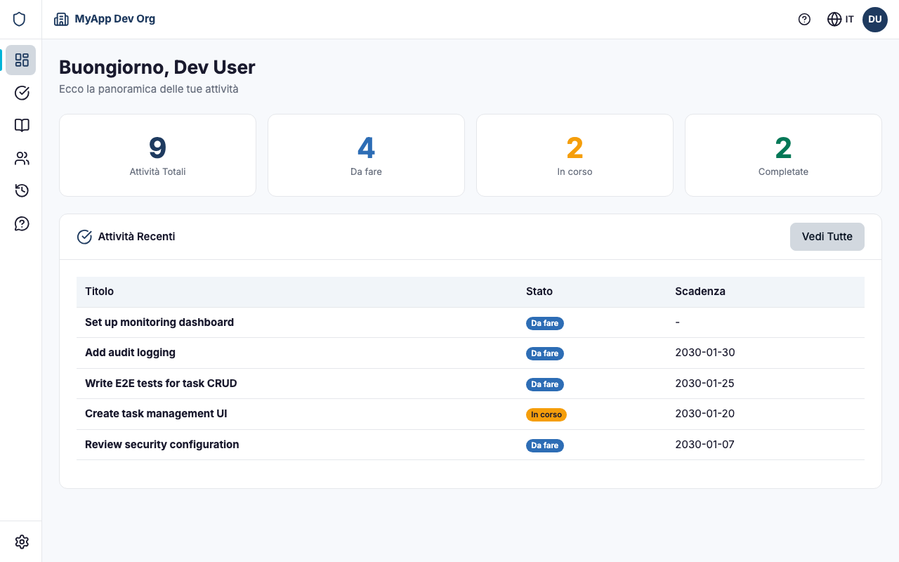
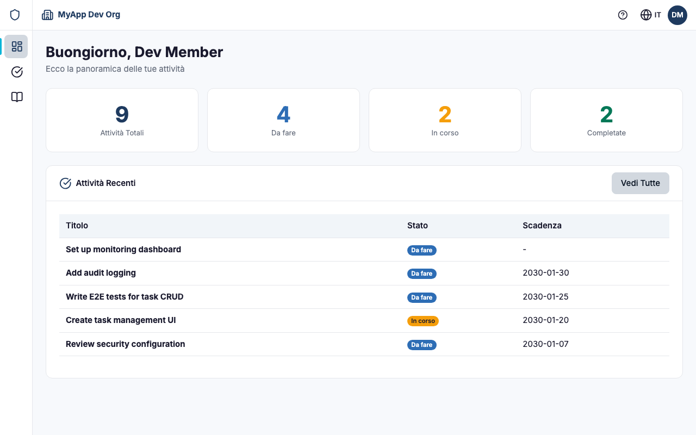

# Aprire solo le pagine consentite dal tuo ruolo

Le pagine di gestione sono aperte solo agli amministratori. Editor e Viewer vedono solo le pagine che possono usare.

## Prima di iniziare

- Gli amministratori vedono tutte le voci. Editor e Viewer non possono aprire le pagine di gestione.

## Passaggi

1. Da amministratore, guarda il menu a sinistra: elenca "Dashboard", "Attività", "Team", "Registro di audit" e "Impostazioni".

   

2. Da Editor o Viewer, il menu elenca solo "Dashboard" e "Attività", e il menu dell'avatar offre solo "Esci".

   

3. Se apri una pagina riservata agli amministratori scrivendo il suo indirizzo, si apre la pagina "Dashboard" con il messaggio "Non hai accesso a questa pagina."

## Cosa vedrai

- Gli amministratori possono aprire le pagine Team, Registro di audit, Organizzazione e Modifica organizzazione.
- Amministratori, Editor e Viewer possono aprire le pagine "Dashboard" e "Attività".

## Da sapere

- Cosa puoi fare dipende dal tuo ruolo nell'organizzazione selezionata nell'intestazione.
- Il ruolo di un membro si cambia nella pagina del Team, da un amministratore.

## Pagine correlate

- [Accedere prima di usare l'app](US-AUTH-02.md)
- [Spostarsi tra le sezioni dell'app](US-AUTH-06.md)
