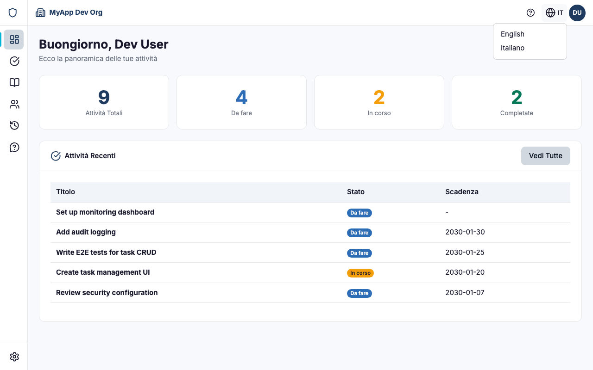

# Cambiare la lingua dell'app

Passa dall'inglese all'italiano e viceversa quando vuoi. Il cambio è immediato.

## Passaggi

1. Clicca il pulsante "Cambia lingua" nell'intestazione. Mostra la lingua attuale, **EN** o **IT**, ed è disponibile con qualsiasi dimensione dello schermo.

   

2. Clicca "Italiano" oppure "English".
3. Menu, etichette e messaggi cambiano subito, senza ricaricare la pagina, e un messaggio conferma la scelta.

## Cosa vedrai

- Un messaggio conferma il cambio, per esempio "Lingua cambiata in Italiano".
- La lingua viene mantenuta al prossimo accesso, su qualsiasi dispositivo.

## Da sapere

- Sono disponibili solo inglese e italiano. Un nuovo account parte in inglese.
- La lingua è tua, non dell'organizzazione: cambiarla non la cambia ai tuoi colleghi.
- Quello che le persone hanno scritto, come i titoli delle attività, non viene tradotto.

## Se qualcosa non va

| Cosa vedi | Cosa fare |
|---|---|
| "Il servizio non ha risposto. Riprova tra qualche minuto." | L'app mantiene la lingua scelta solo fino a quando esci. Scegli di nuovo la lingua più tardi, così viene mantenuta al prossimo accesso. |

## Pagine correlate

- [Iniziare a usare l'app al primo accesso](US-AUTH-04.md)
- [Spostarsi tra le sezioni dell'app](US-AUTH-06.md)
