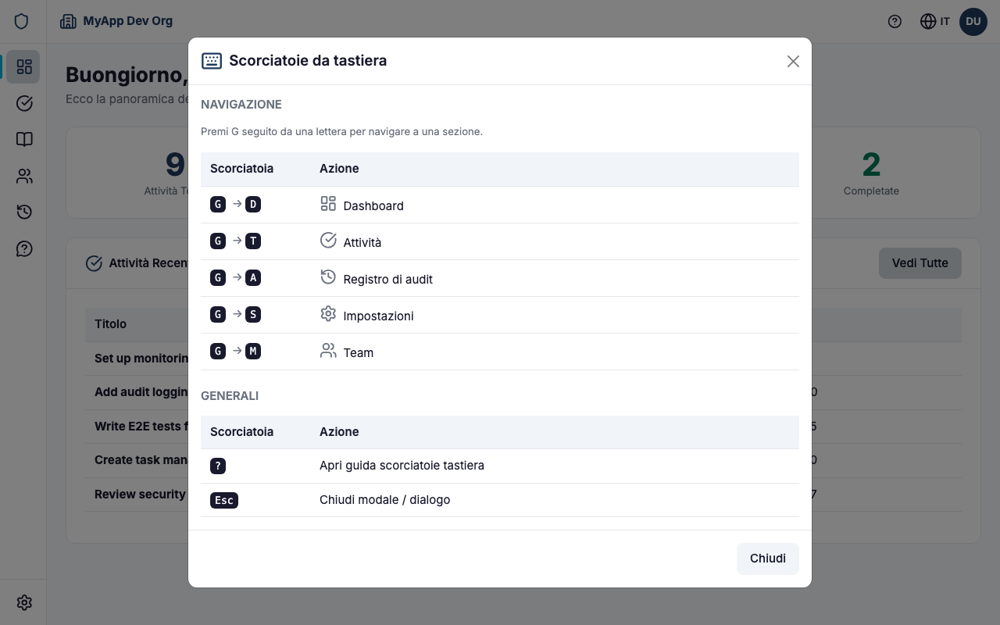
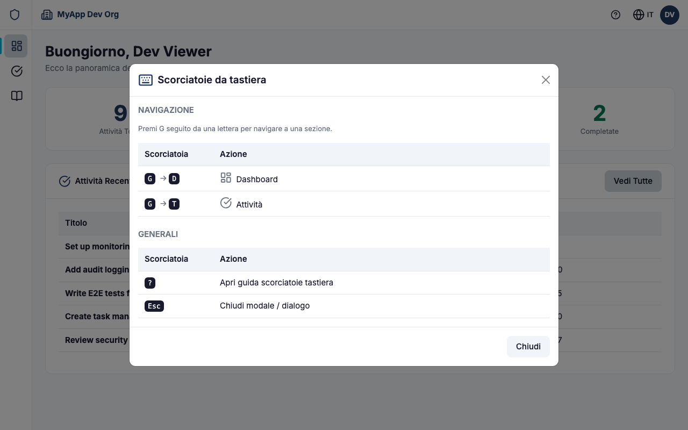

# Spostarsi tra le pagine con la tastiera

Apri le pagine principali con pochi tasti, senza usare il mouse.

## Passaggi

1. Premi **G** e poi **D** per aprire la pagina "Dashboard", oppure **G** e poi **T** per aprire la pagina "Attività".
2. Da amministratore, premi **G** e poi **M** per la pagina del Team, **G** e poi **A** per il Registro di audit, oppure **G** e poi **S** per la pagina Organizzazione.
3. Premi **?** per aprire la finestra "Scorciatoie da tastiera". Elenca solo le scorciatoie che puoi usare.

   

4. Da Editor o Viewer, la finestra elenca solo le scorciatoie di Dashboard e Attività.

   

## Cosa vedrai

- Si apre la pagina della scorciatoia che hai premuto.

## Da sapere

- Editor e Viewer hanno solo le scorciatoie delle pagine Dashboard e Attività: per loro G seguito da M, A o S non fa nulla.
- Le scorciatoie non fanno nulla mentre scrivi in un campo o mentre è aperta una finestra: i tasti digitati in un campo sono testo.
- Non puoi scegliere altri tasti e non ci sono scorciatoie per le azioni dentro una pagina, come creare un'attività.

## Pagine correlate

- [Spostarsi tra le sezioni dell'app](US-AUTH-06.md)
- [Aprire solo le pagine consentite dal tuo ruolo](US-AUTH-07.md)
