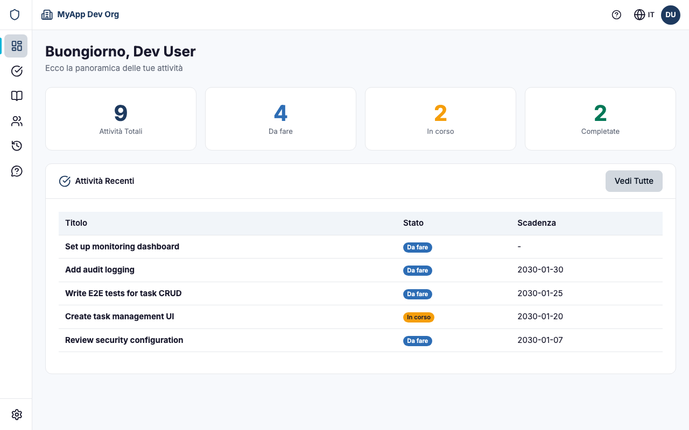
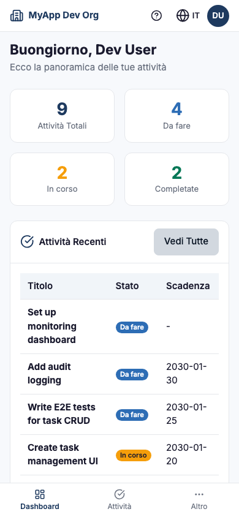
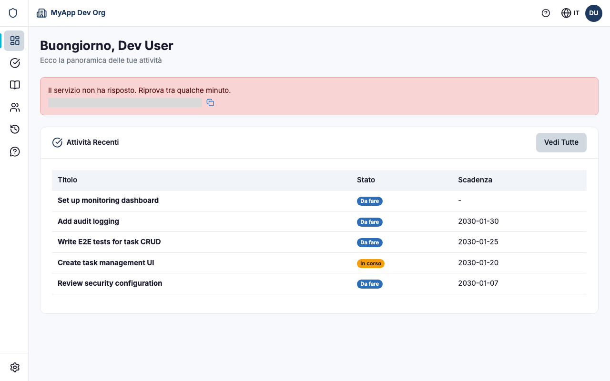

# Vedere i conteggi delle attività

Guarda quante attività ha la tua organizzazione in ogni stato, per avere subito un'idea del carico di lavoro.

## Passaggi

1. Nel menu, fai clic su "Dashboard". È anche la prima pagina che vedi dopo l'accesso.

   

## Cosa vedrai

- Quattro riquadri: "Attività Totali", "Da fare", "In corso" e "Completate", ognuno con un numero.
- Mentre i numeri si caricano, al loro posto compare un indicatore di caricamento.
- Su uno schermo largo i riquadri stanno in una sola riga; su uno schermo stretto sono due per riga.
- Un'organizzazione senza attività mostra 0 su ogni riquadro.

## Da sapere

- "Attività Totali" conta tutte le attività dell'organizzazione, comprese quelle annullate. Le attività annullate non sono contate negli altri riquadri.
- I numeri descrivono sempre l'organizzazione selezionata e tutti i suoi membri vedono gli stessi valori.
- Non si può scegliere un periodo o una persona, e un clic su un riquadro non apre l'elenco delle attività.

## Se qualcosa non va

| Cosa vedi | Cosa fare |
|---|---|
| "Il servizio non ha risposto. Riprova tra qualche minuto." | Ricarica la pagina più tardi. |

## Pagine correlate

- [Vedere le ultime attività](US-DASH-02.md)
- [Aprire l'elenco delle attività dalla dashboard](US-DASH-03.md)
- [Leggere il saluto nella dashboard](US-DASH-04.md)
