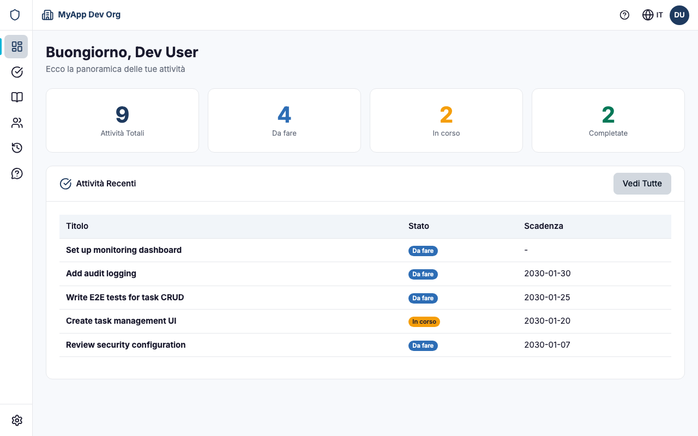
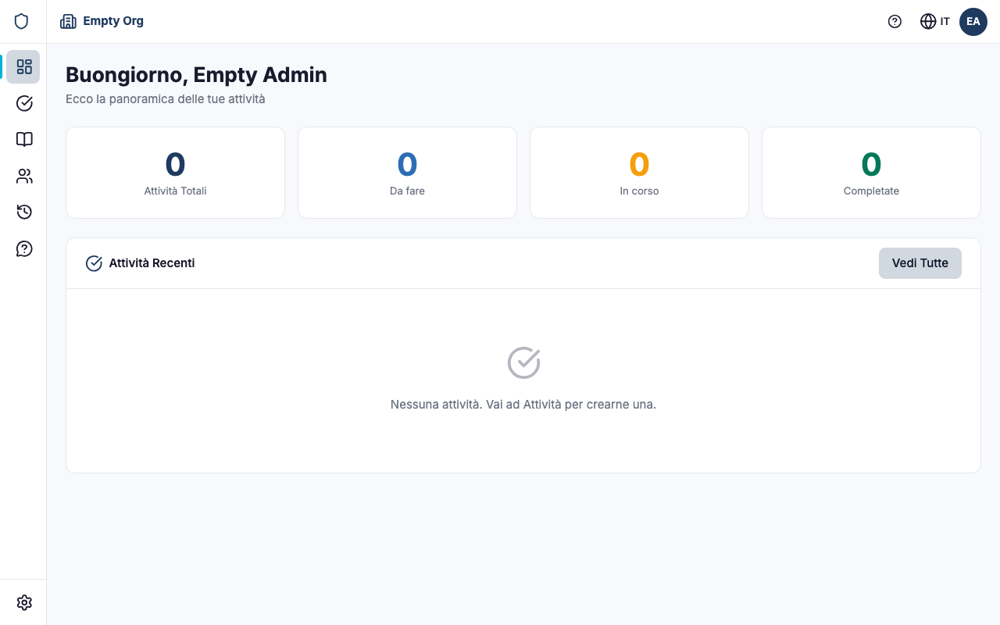
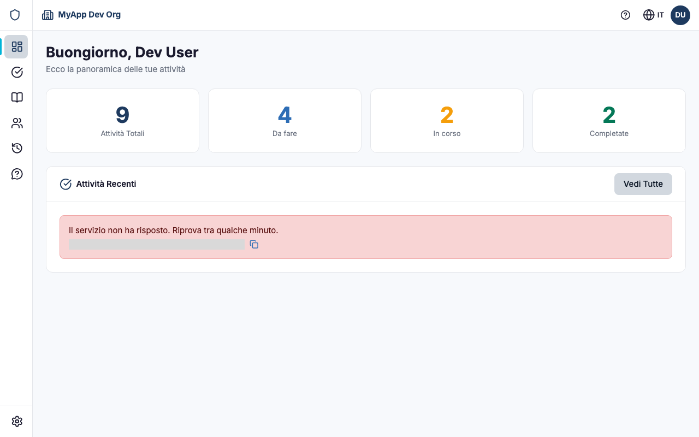

# Vedere le ultime attività

Guarda nella dashboard le attività create più di recente, per capire cosa richiede attenzione senza aprire l'elenco completo.

## Passaggi

1. Nel menu, fai clic su "Dashboard".
2. Leggi la sezione "Attività Recenti" sotto i quattro riquadri.

   

## Cosa vedrai

- Una tabella con le colonne "Titolo", "Stato" e "Scadenza".
- Lo stato come etichetta colorata: "Da fare", "In corso", "Completata" o "Annullata".
- Un'attività senza scadenza mostra "-".
- Al massimo cinque attività, dalla più recente.
- Quando non ci sono attività, al posto della tabella gli Admin e gli Editor leggono "Nessuna attività. Vai ad Attività per crearne una." e i Visualizzatori leggono "Nessuna attività".

## Da sapere

- Le cinque attività sono le più recenti tra tutte quelle dell'organizzazione, qualunque sia il loro stato.
- Non si può scegliere quante attività mostrare e non si può modificare un'attività dalla dashboard.

## Se qualcosa non va

| Cosa vedi | Cosa fare |
|---|---|
| "Il servizio non ha risposto. Riprova tra qualche minuto." | Ricarica la pagina più tardi. |

## Pagine correlate

- [Vedere i conteggi delle attività](US-DASH-01.md)
- [Aprire l'elenco delle attività dalla dashboard](US-DASH-03.md)
- [Leggere il saluto nella dashboard](US-DASH-04.md)
