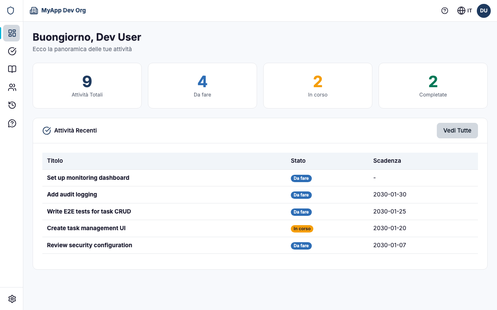

# Leggere il saluto nella dashboard

Quando apri la dashboard vieni salutato per nome, così la pagina è più personale e sai che è aggiornata.

## Passaggi

1. Nel menu, fai clic su "Dashboard".

   

## Cosa vedrai

- Un saluto seguito da una virgola e dal tuo nome: "Buongiorno" prima delle 12:00, "Buon pomeriggio" dalle 12:00 alle 17:59 e "Buonasera" dalle 18:00.
- Sotto, la riga "Ecco la panoramica delle tue attività".
- Se l'applicazione non conosce il tuo nome, compare solo il saluto.
- Se usi l'applicazione in italiano, entrambe le righe sono in italiano.

## Da sapere

- L'ora che conta è quella del tuo dispositivo, non quella dell'organizzazione.
- Il testo del saluto è fisso: non si può cambiare e non cambia nei giorni di festa.

## Pagine correlate

- [Vedere i conteggi delle attività](US-DASH-01.md)
- [Vedere le ultime attività](US-DASH-02.md)
- [Aprire l'elenco delle attività dalla dashboard](US-DASH-03.md)
