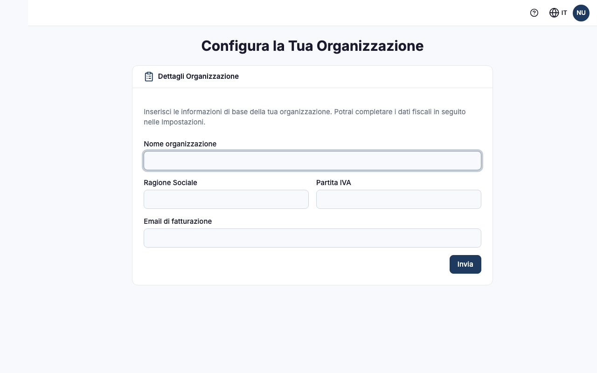

# Configurare la tua organizzazione al primo accesso

Se non fai ancora parte di nessuna organizzazione, l'app ti guida a crearne una prima di iniziare a lavorare.

## Passaggi

1. Apri nel browser l'indirizzo dell'app e accedi.
2. Si apre la pagina "Configura la Tua Organizzazione", qualunque pagina tu abbia provato ad aprire. Ha un solo passaggio, "Dettagli Organizzazione", e un pulsante "Invia".

   

## Cosa vedrai

- La pagina "Configura la Tua Organizzazione" è mostrata nella tua lingua, inglese o italiano.
- Non si può saltare: senza un'organizzazione non c'è nient'altro da usare.

## Da sapere

- La pagina compare finché, e solo finché, non fai parte di nessuna organizzazione.
- Se fai parte di almeno un'organizzazione non la vedi mai. Vale anche per le persone invitate al loro primo accesso, ed è per questo che i tuoi colleghi potrebbero non vederla.
- La pagina non permette di scegliere la lingua né di invitare colleghi. Per cambiare lingua usa il pulsante "Cambia lingua" nell'intestazione.

## Pagine correlate

- [Creare la tua organizzazione con la procedura guidata](US-ONBOARD-02.md)
