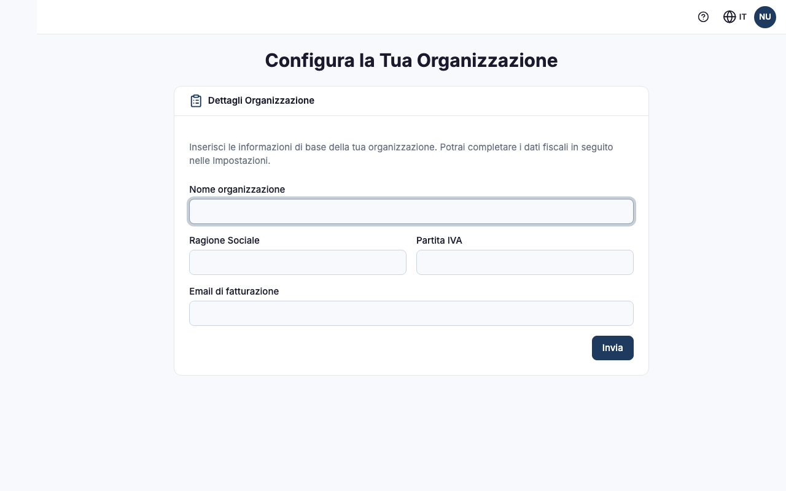
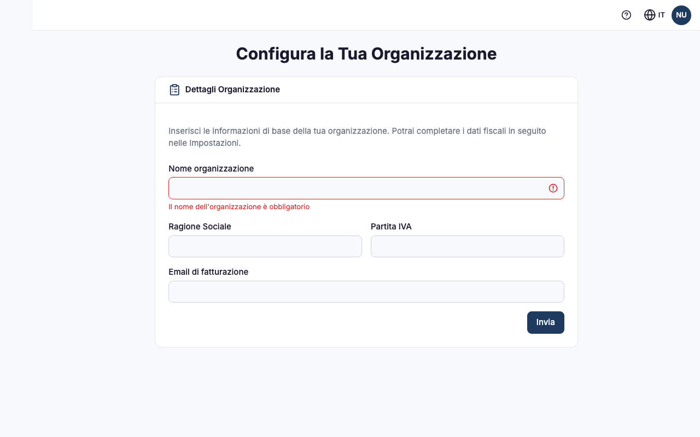
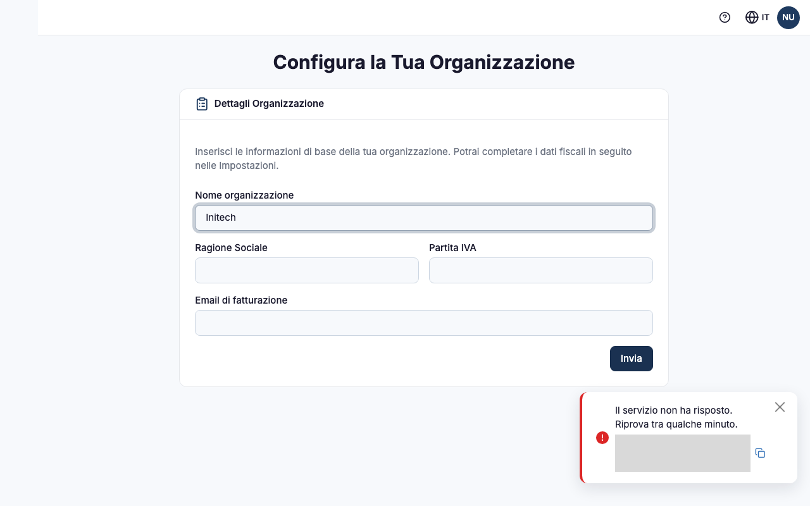

# Creare la tua organizzazione con la procedura guidata

Inserisci nella procedura guidata i dati di base della tua organizzazione per avere un'organizzazione in cui lavorare.

## Prima di iniziare

- Non fai ancora parte di nessuna organizzazione, quindi è aperta la pagina "Configura la Tua Organizzazione".

## Passaggi

1. Scrivi il nome della tua organizzazione in "Nome organizzazione". È l'unico campo obbligatorio.

   

2. Se vuoi, compila "Ragione Sociale", "Partita IVA" ed "Email di fatturazione".
3. Clicca "Invia". Se "Nome organizzazione" è vuoto, compare il messaggio "Il nome dell'organizzazione è obbligatorio" e non viene creato nulla.

   

4. Mentre l'organizzazione viene creata la pagina mostra "Creazione organizzazione in corso...".
5. Compare il messaggio "Organizzazione creata con successo!" e si apre la pagina "Dashboard" della nuova organizzazione.

## Cosa vedrai

- L'intestazione mostra il nome della tua nuova organizzazione.
- Sei l'amministratore della nuova organizzazione e vedi "Impostazioni" nel menu.

## Da sapere

- Un nome fatto solo di spazi conta come vuoto.
- Se lasci vuota la "Ragione Sociale", viene riempita con il nome dell'organizzazione. Il paese parte da "IT".
- Gli altri dati fiscali e di fatturazione si completano più tardi nelle Impostazioni.
- La procedura non chiede settore, modello, lingua o anno fiscale e non crea una seconda organizzazione: è pensata solo per chi non ne ha nessuna.

## Se qualcosa non va

| Cosa vedi | Cosa fare |
|---|---|
| "Il nome dell'organizzazione è obbligatorio" | Scrivi in "Nome organizzazione" un nome che non sia fatto solo di spazi, poi clicca di nuovo "Invia". |
| "Il servizio non ha risposto. Riprova tra qualche minuto." | Clicca di nuovo "Invia" più tardi. La procedura conserva quello che hai scritto. |

## Pagine correlate

- [Configurare la tua organizzazione al primo accesso](US-ONBOARD-01.md)
