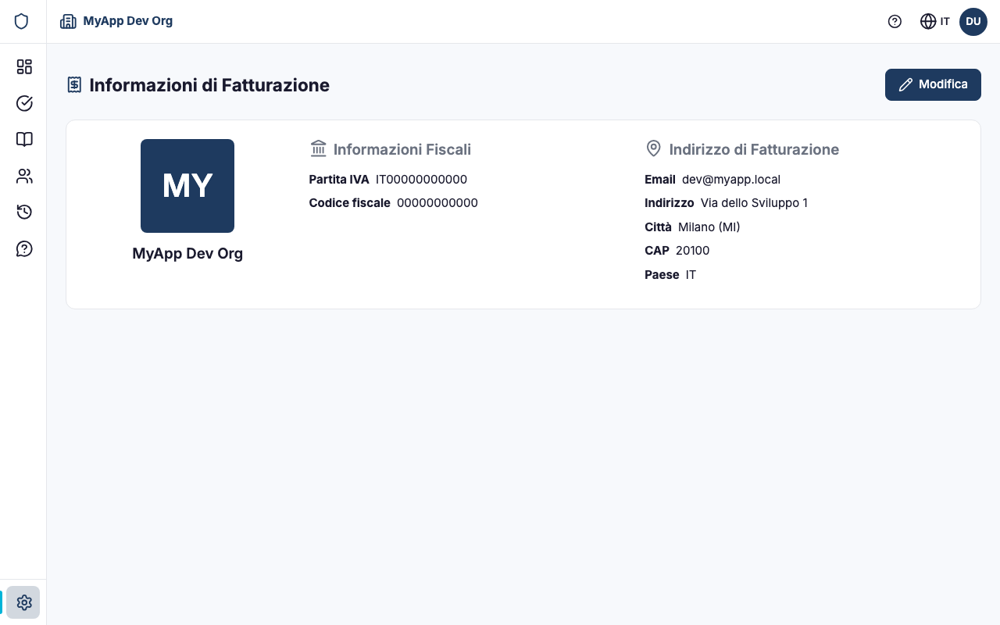
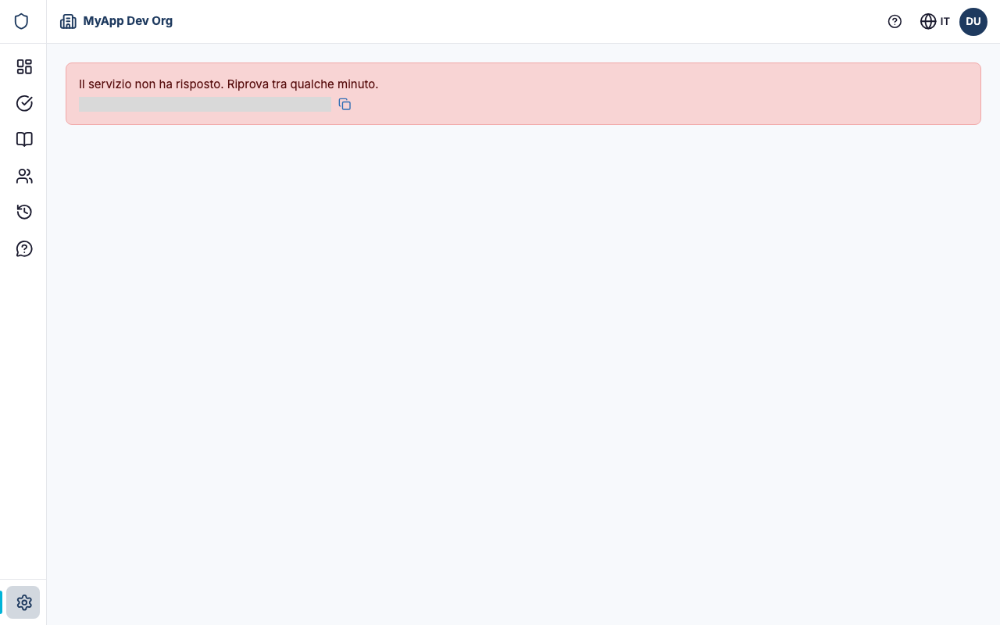

# Vedere i dati dell'organizzazione

Controlla il profilo e i dati di fatturazione della tua organizzazione, per sapere che i dati aziendali sono corretti.

## Prima di iniziare

- Solo gli Admin possono farlo. Gli Editor e i Visualizzatori non vedono "Impostazioni"; se aprono la pagina dal suo indirizzo, vengono portati alla Dashboard con il messaggio "Non hai accesso a questa pagina."

## Passaggi

1. Nel menu, fai clic su "Impostazioni".

   

## Cosa vedrai

- La pagina "Informazioni di Fatturazione", con il logo (o le prime due lettere del nome se non c'è il logo) e il nome dell'organizzazione.
- Sotto "Informazioni Fiscali": "Partita IVA" e "Codice fiscale".
- Sotto "Indirizzo di Fatturazione": "Email", "Indirizzo", "Città" con la provincia tra parentesi, "CAP" e "Paese".
- Un dato non compilato mostra "-".
- Il pulsante "Modifica", che apre la pagina in cui cambi i dati.

## Da sapere

- La pagina mostra l'organizzazione selezionata nell'intestazione.
- Qui non si può eliminare l'organizzazione, vederne i membri (lo fa la pagina Team) né gestire piani di fatturazione e fatture.

## Se qualcosa non va

| Cosa vedi | Cosa fare |
|---|---|
| "Il servizio non ha risposto. Riprova tra qualche minuto." | Ricarica la pagina più tardi. |

## Pagine correlate

- [Modificare i dati dell'organizzazione](US-ORG-02.md)
- [Caricare il logo dell'organizzazione](US-ORG-03.md)
- [Vedere i membri del team](US-ORG-04.md)
- [Invitare un membro nel team](US-ORG-05.md)
- [Cambiare il ruolo di un membro](US-ORG-06.md)
- [Rimuovere un membro dal team](US-ORG-07.md)
