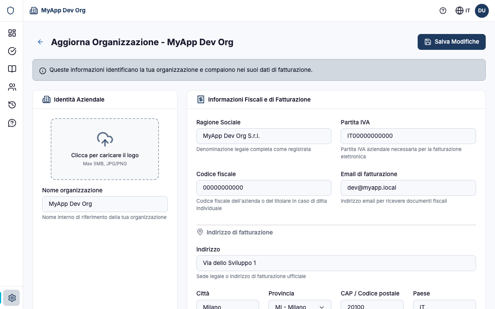
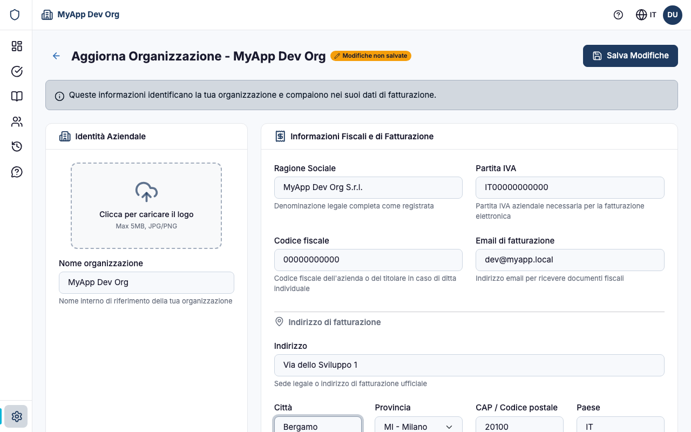
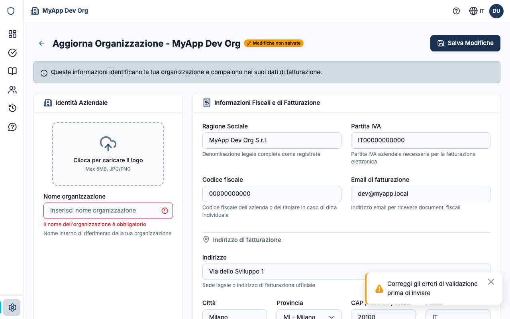
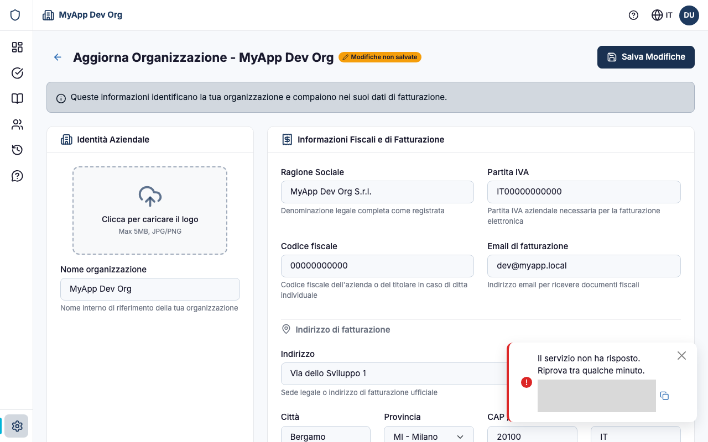

# Modificare i dati dell'organizzazione

Cambia il nome e i dati di fatturazione della tua organizzazione, perché contratti e fatture riportino i dati aziendali corretti.

## Prima di iniziare

- Solo gli Admin possono farlo.

## Passaggi

1. Nel menu, fai clic su "Impostazioni".
2. Fai clic su "Modifica". Si apre la pagina "Aggiorna Organizzazione" con i valori attuali.

   
3. Cambia quello che serve. Tutti i campi sono obbligatori: "Nome organizzazione", "Ragione Sociale", "Partita IVA", "Codice fiscale", "Email di fatturazione", "Indirizzo", "Città", "Provincia", "CAP / Codice postale" e "Paese".

   
4. Fai clic su "Salva Modifiche".

## Cosa vedrai

- Il messaggio "L'organizzazione è stata aggiornata con successo".
- Si apre la pagina Organizzazione con i nuovi valori.
- Finché i valori sono diversi da quelli salvati, accanto al titolo compare il badge "Modifiche non salvate".

## Da sapere

- La freccia indietro riporta alla pagina Organizzazione senza salvare.
- L'applicazione non controlla che la partita IVA o il codice fiscale esistano davvero e non ci sono modelli per settore.

## Se qualcosa non va

| Cosa vedi | Cosa fare |
|---|---|
| "Il nome dell'organizzazione è obbligatorio" | Compila il campo sotto cui compare il messaggio. Gli altri campi obbligatori mostrano un messaggio simile, per esempio "La ragione sociale è obbligatoria". |
| "Correggi gli errori di validazione prima di inviare" | Correggi i campi segnati in rosso, poi fai di nuovo clic su "Salva Modifiche". |
| "Formato email non valido" | Scrivi un indirizzo email valido in "Email di fatturazione". |
| "Il CAP deve essere di 5 cifre" | Scrivi esattamente cinque cifre in "CAP / Codice postale". |
| "Il servizio non ha risposto. Riprova tra qualche minuto." | Fai di nuovo clic su "Salva Modifiche" più tardi. La pagina conserva i valori che avevi scritto. |

## Pagine correlate

- [Vedere i dati dell'organizzazione](US-ORG-01.md)
- [Caricare il logo dell'organizzazione](US-ORG-03.md)
- [Vedere i membri del team](US-ORG-04.md)
- [Invitare un membro nel team](US-ORG-05.md)
- [Cambiare il ruolo di un membro](US-ORG-06.md)
- [Rimuovere un membro dal team](US-ORG-07.md)
