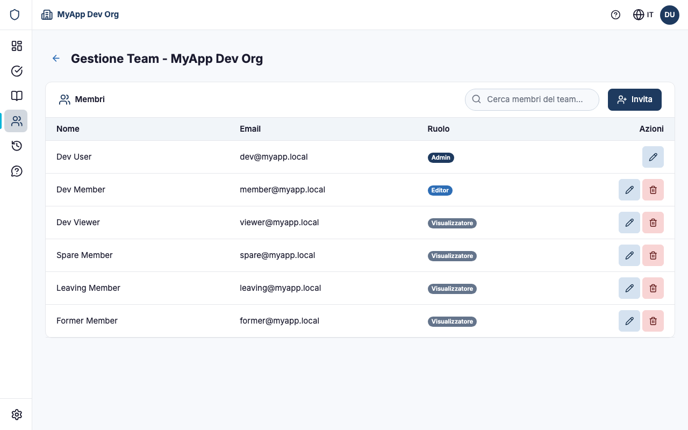
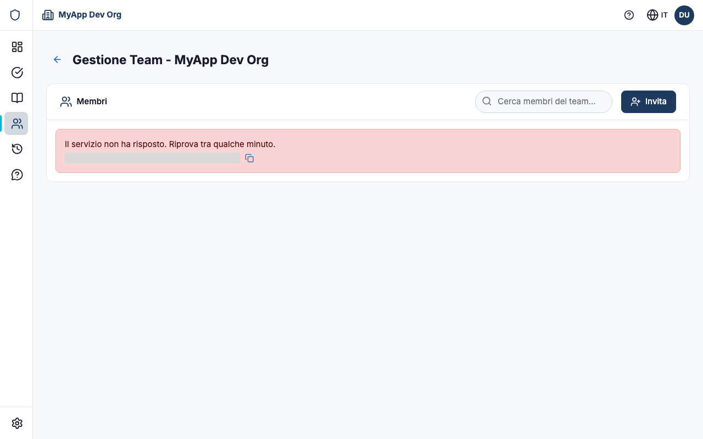

# Vedere i membri del team

Guarda chi fa parte della tua organizzazione e con quale ruolo, per sapere chi può fare cosa.

## Prima di iniziare

- Solo gli Admin possono farlo. Gli Editor e i Visualizzatori non vedono "Team"; se aprono la pagina dal suo indirizzo, vengono portati alla Dashboard con il messaggio "Non hai accesso a questa pagina."

## Passaggi

1. Nel menu, fai clic su "Team".

   
2. Per trovare qualcuno, scrivi una parte del nome o dell'email in "Cerca membri del team...".

## Cosa vedrai

- La pagina "Gestione Team" seguita dal nome dell'organizzazione.
- La tabella "Membri" con nome, email e ruolo ("Admin", "Editor" o "Visualizzatore") di ogni membro.
- Sotto "Inviti in Attesa", le persone invitate che non hanno ancora effettuato l'accesso, con nome, email e data di invio.
- Quando nulla corrisponde alla ricerca, la tabella dice "Nessun membro del team corrisponde alla ricerca".
- La freccia indietro apre la pagina Organizzazione.

## Da sapere

- La ricerca non distingue tra maiuscole e minuscole.
- "Membri" elenca solo le persone che hanno già effettuato l'accesso; le persone invitate compaiono solo sotto "Inviti in Attesa".
- Non si può ordinare la tabella, dividerla in pagine, né inviare di nuovo o annullare un invito.

## Se qualcosa non va

| Cosa vedi | Cosa fare |
|---|---|
| "Il servizio non ha risposto. Riprova tra qualche minuto." | Ricarica la pagina più tardi. |

## Pagine correlate

- [Vedere i dati dell'organizzazione](US-ORG-01.md)
- [Modificare i dati dell'organizzazione](US-ORG-02.md)
- [Caricare il logo dell'organizzazione](US-ORG-03.md)
- [Invitare un membro nel team](US-ORG-05.md)
- [Cambiare il ruolo di un membro](US-ORG-06.md)
- [Rimuovere un membro dal team](US-ORG-07.md)
