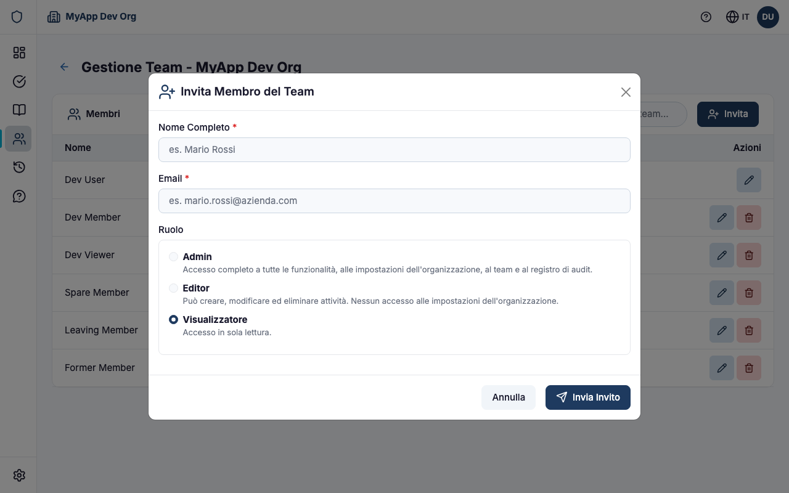

# Invitare un membro nel team

Invita un collega via email e assegnagli un ruolo, così può lavorare nella tua organizzazione.

## Prima di iniziare

- Solo gli Admin possono farlo.

## Passaggi

1. Nel menu, fai clic su "Team".
2. Fai clic su "Invita". Si apre il dialogo "Invita Membro del Team".

   
3. In "Nome Completo" scrivi il nome della persona.
4. In "Email" scrivi il suo indirizzo email.
5. Scegli il ruolo: "Admin", "Editor" o "Visualizzatore". Ognuno ha una breve descrizione.
6. Fai clic su "Invia Invito".

## Cosa vedrai

- Il dialogo si chiude e compare il messaggio "Invito inviato con successo".
- La persona compare sotto "Inviti in Attesa".

## Da sapere

- Quando il dialogo si apre è selezionato "Visualizzatore".
- La persona resta sotto "Inviti in Attesa", e non sotto "Membri", finché non effettua l'accesso.
- Se fai clic su "Annulla", il dialogo si chiude e nessuno viene invitato.
- Si invita una persona alla volta e non si può inviare di nuovo o annullare un invito.

## Se qualcosa non va

| Cosa vedi | Cosa fare |
|---|---|
| "Il nome completo è obbligatorio" | Scrivi il nome in "Nome Completo". |
| "L'indirizzo email è obbligatorio" | Scrivi l'indirizzo in "Email". |
| "Inserisci un indirizzo email valido" | Controlla l'indirizzo e scrivilo per intero, per esempio nome@azienda.com. |
| "L'utente è già membro di questa organizzazione." | Usa un'altra email, oppure cambia il ruolo di quel membro. |
| "Esiste già un invito in sospeso per questo indirizzo email." | Aspetta che la persona acceda; non serve un secondo invito. |

## Pagine correlate

- [Vedere i dati dell'organizzazione](US-ORG-01.md)
- [Modificare i dati dell'organizzazione](US-ORG-02.md)
- [Caricare il logo dell'organizzazione](US-ORG-03.md)
- [Vedere i membri del team](US-ORG-04.md)
- [Cambiare il ruolo di un membro](US-ORG-06.md)
- [Rimuovere un membro dal team](US-ORG-07.md)
