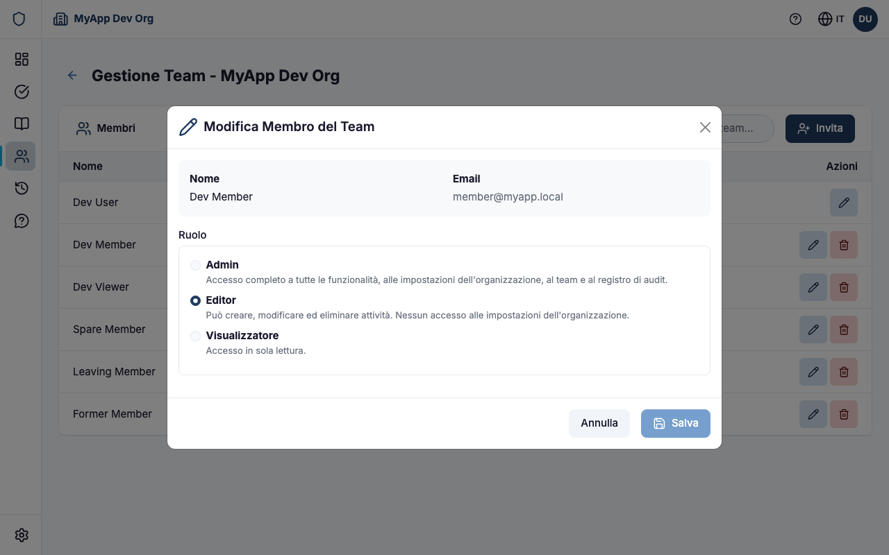

# Cambiare il ruolo di un membro

Assegna a un membro un ruolo diverso, così ogni persona ha il livello di accesso giusto.

## Prima di iniziare

- Solo gli Admin possono farlo.

## Passaggi

1. Nel menu, fai clic su "Team".
2. Sulla riga del membro fai clic sul pulsante "Modifica" (la matita). Si apre il dialogo "Modifica Membro del Team".

   
3. Scegli un altro ruolo: "Admin", "Editor" o "Visualizzatore".
4. Fai clic su "Salva".

## Cosa vedrai

- Il dialogo si chiude e compare il messaggio "Membro aggiornato con successo".
- La riga del membro mostra il nuovo ruolo.

## Da sapere

- "Salva" resta disattivato finché non scegli un ruolo diverso. Nome ed email sono visibili ma non si possono cambiare.
- Se fai clic su "Annulla", il dialogo si chiude e non cambia nulla.
- Se abbassi il tuo stesso ruolo, il dialogo avvisa "Stai rimuovendo i tuoi privilegi di Admin. Questa azione non può essere annullata da te stesso." e chiede una conferma: "Salva" è sostituito da "Torna indietro" e "Conferma Declassamento".
- Un'organizzazione ha sempre almeno un Admin.
- Non si possono cambiare più membri insieme.

## Se qualcosa non va

| Cosa vedi | Cosa fare |
|---|---|
| "Un'organizzazione deve avere almeno un Admin." | Assegna prima il ruolo di Admin a un altro membro. |
| "Questo membro non fa più parte del team." | Un altro Admin l'ha rimosso. Continua con la tabella aggiornata, dove il membro non compare più. |

## Pagine correlate

- [Vedere i dati dell'organizzazione](US-ORG-01.md)
- [Modificare i dati dell'organizzazione](US-ORG-02.md)
- [Caricare il logo dell'organizzazione](US-ORG-03.md)
- [Vedere i membri del team](US-ORG-04.md)
- [Invitare un membro nel team](US-ORG-05.md)
- [Rimuovere un membro dal team](US-ORG-07.md)
