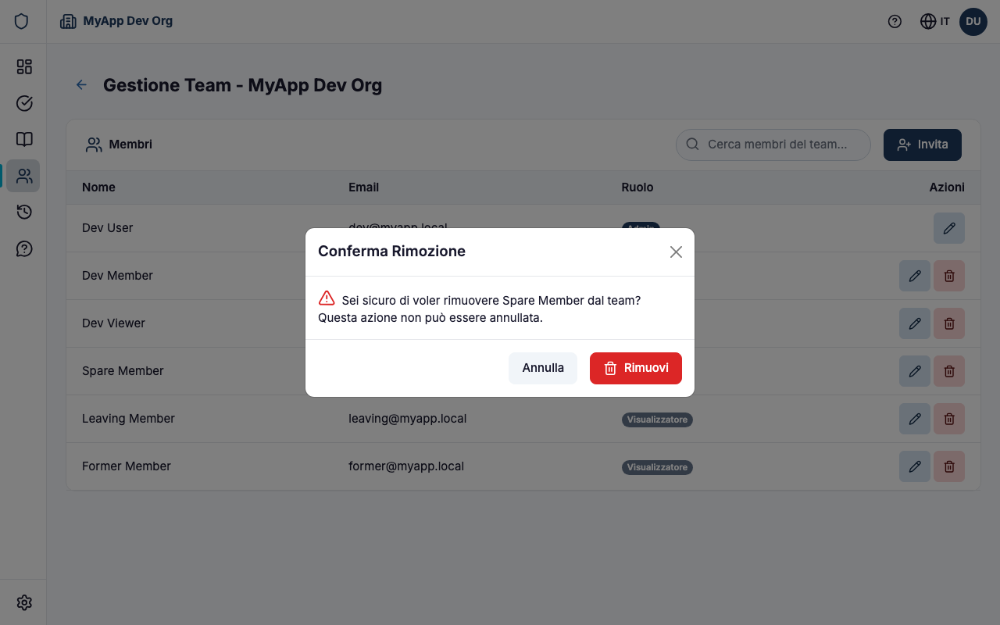

# Rimuovere un membro dal team

Togli una persona dalla tua organizzazione, così chi se n'è andato non ha più accesso.

## Prima di iniziare

- Solo gli Admin possono farlo.
- Gli Admin non hanno il pulsante "Rimuovi". Per rimuovere un Admin, abbassa prima il suo ruolo.

## Passaggi

1. Nel menu, fai clic su "Team".
2. Sulla riga del membro fai clic su "Rimuovi". Si apre il dialogo "Conferma Rimozione".

   
3. Fai clic su "Rimuovi" nel dialogo per confermare, oppure su "Annulla" per tenere il membro.

## Cosa vedrai

- Il dialogo chiede "Sei sicuro di voler rimuovere" seguito dal nome e da "dal team? Questa azione non può essere annullata."
- Dopo la conferma il dialogo si chiude e compare il messaggio "Membro rimosso con successo".
- Il membro non è più nella tabella "Membri".

## Da sapere

- Una rimozione non si può annullare. Per far rientrare la persona, invitala di nuovo.
- Qui non si può annullare un invito in sospeso.

## Se qualcosa non va

| Cosa vedi | Cosa fare |
|---|---|
| "Questo membro non fa più parte del team." | Un altro Admin l'ha rimosso prima di te. Continua con la tabella aggiornata, dove il membro non compare più. |

## Pagine correlate

- [Vedere i dati dell'organizzazione](US-ORG-01.md)
- [Modificare i dati dell'organizzazione](US-ORG-02.md)
- [Caricare il logo dell'organizzazione](US-ORG-03.md)
- [Vedere i membri del team](US-ORG-04.md)
- [Invitare un membro nel team](US-ORG-05.md)
- [Cambiare il ruolo di un membro](US-ORG-06.md)
