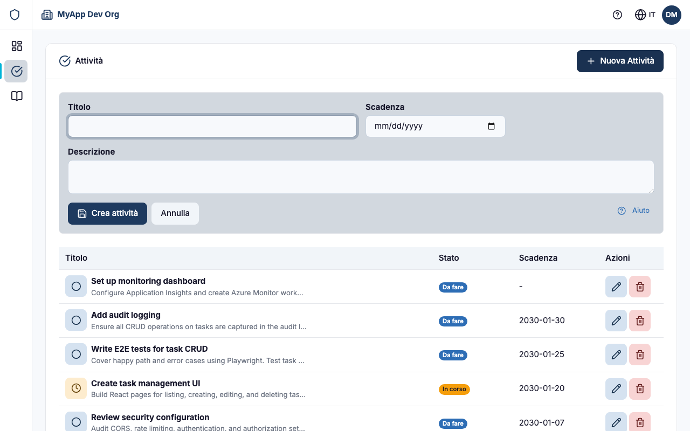
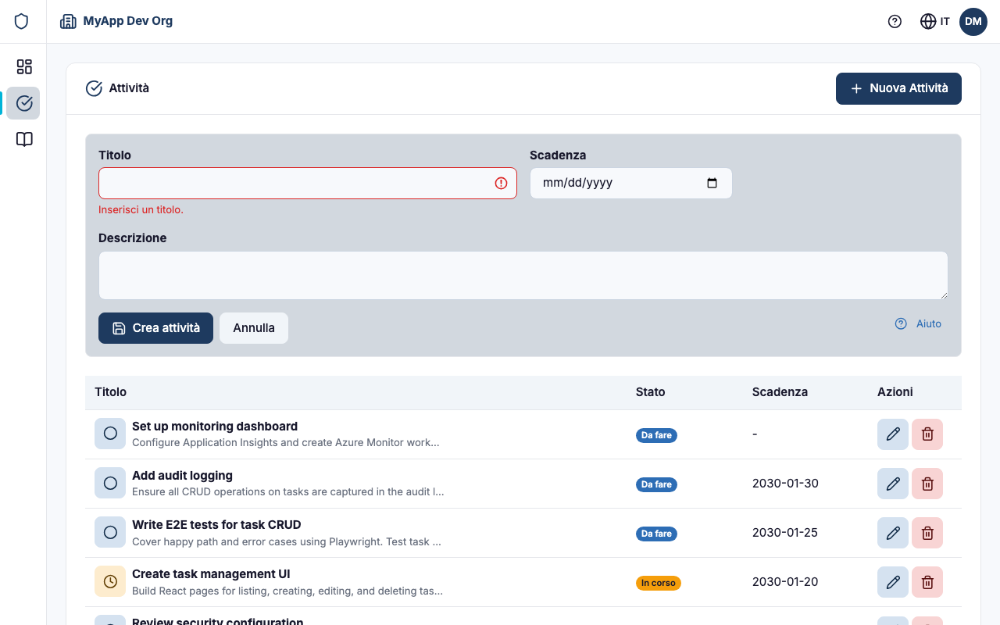
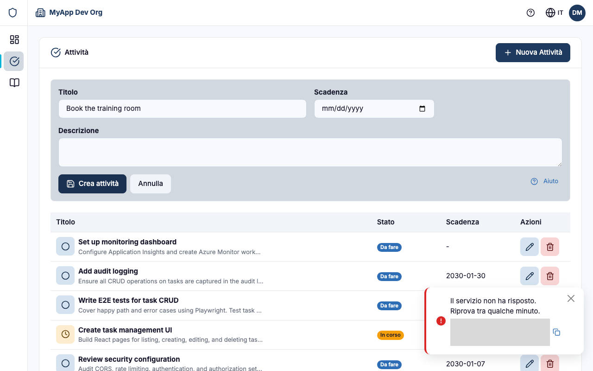

# Creare un'attività

Aggiungi un'attività con un titolo, così il team vede cosa c'è da fare. Se vuoi puoi indicare anche una scadenza e una descrizione.

## Prima di iniziare

- Solo gli Admin e gli Editor possono creare attività. I Visualizzatori non vedono il pulsante "Nuova Attività".

## Passaggi

1. Nel menu, fai clic su "Attività".
2. Fai clic su "Nuova Attività". Sopra l'elenco si apre un modulo.

   
3. Nel campo "Titolo" scrivi il nome dell'attività. È l'unico campo obbligatorio.
4. Se vuoi, scegli una data in "Scadenza" e aggiungi dettagli in "Descrizione".
5. Fai clic su "Crea attività".

## Cosa vedrai

- Il modulo si chiude.
- La nuova attività è la prima riga dell'elenco, con la descrizione sotto il titolo, la scadenza e lo stato "Da fare".

## Da sapere

- Una nuova attività parte sempre come "Da fare".
- Un titolo fatto solo di spazi conta come vuoto.
- Il titolo può avere fino a 200 caratteri e la descrizione fino a 2000; quello che scrivi in più viene ignorato.
- Se fai clic su "Annulla", il modulo si chiude e nessuna attività viene aggiunta.
- Non si può assegnare l'attività a una persona, né crearne più di una alla volta, né allegare file.

## Se qualcosa non va

| Cosa vedi | Cosa fare |
|---|---|
| "Inserisci un titolo." | Scrivi un titolo nel campo "Titolo", poi fai di nuovo clic su "Crea attività". |
| "Il tuo ruolo non consente questa modifica." | Mentre il modulo era aperto il tuo ruolo è diventato Visualizzatore. Chiedi a un Admin dell'organizzazione il ruolo di Editor. |
| "Il servizio non ha risposto. Riprova tra qualche minuto." | Fai di nuovo clic su "Crea attività" più tardi. Il modulo conserva quello che avevi scritto. |

## Pagine correlate

- [Modificare un'attività](US-TASK-02.md)
- [Cambiare lo stato di un'attività](US-TASK-03.md)
- [Eliminare un'attività](US-TASK-04.md)
- [Vedere l'elenco delle attività](US-TASK-05.md)
