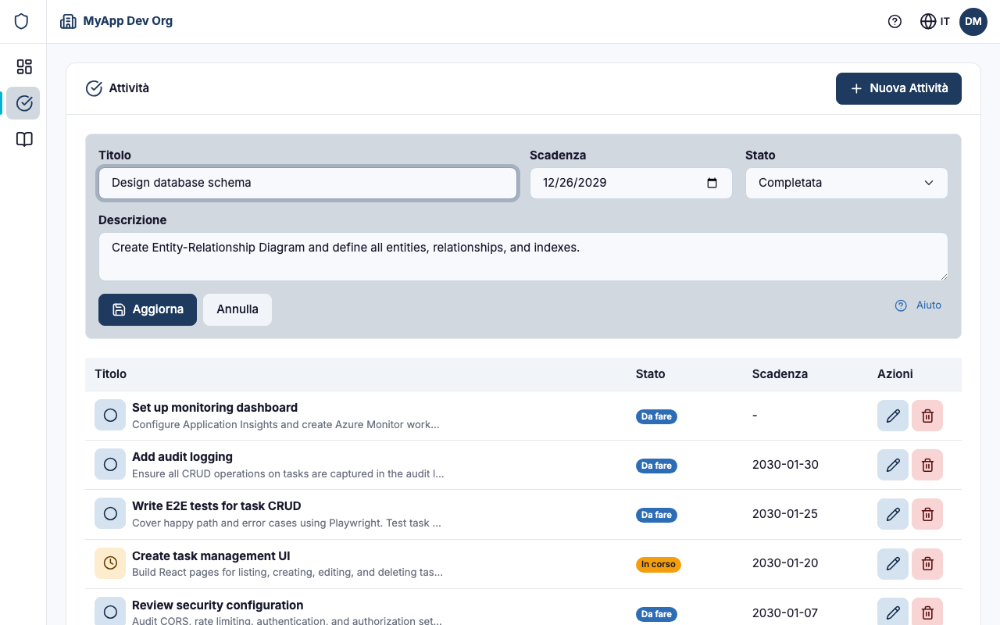

# Modificare un'attività

Cambia titolo, scadenza, stato o descrizione di un'attività, così l'elenco resta corretto quando i piani cambiano.

## Prima di iniziare

- Solo gli Admin e gli Editor possono modificare le attività. I Visualizzatori non vedono il pulsante "Modifica".

## Passaggi

1. Nel menu, fai clic su "Attività".
2. Sulla riga dell'attività fai clic sul pulsante "Modifica" (la matita). Sopra l'elenco si apre un modulo con i valori di quell'attività.

   
3. Cambia quello che serve in "Titolo", "Scadenza", "Stato" o "Descrizione". Lo stato può essere "Da fare", "In corso", "Completata" o "Annullata".
4. Fai clic su "Aggiorna".

## Cosa vedrai

- Il modulo si chiude.
- La riga mostra i nuovi valori, con il titolo che hai scritto.

## Da sapere

- Viene aggiornato solo quello che hai cambiato; tutto il resto dell'attività resta com'era.
- Lo stato scelto nel modulo è quello che compare sulla riga.
- Se fai clic su "Annulla", il modulo si chiude e l'attività mantiene i valori precedenti.
- Non si può cambiare a chi è assegnata un'attività né modificarne più di una alla volta.
- La cronologia delle modifiche di un'attività si trova nel Registro di audit, che possono aprire solo gli Admin.

## Se qualcosa non va

| Cosa vedi | Cosa fare |
|---|---|
| "Inserisci un titolo." | Scrivi un titolo nel campo "Titolo", poi fai di nuovo clic su "Aggiorna". |
| "Questa attività non esiste più." | Un altro membro l'ha eliminata. Continua con l'elenco aggiornato, dove l'attività non compare più. |
| "Il tuo ruolo non consente questa modifica." | Mentre il modulo era aperto il tuo ruolo è diventato Visualizzatore. Chiedi a un Admin dell'organizzazione il ruolo di Editor. |

## Pagine correlate

- [Creare un'attività](US-TASK-01.md)
- [Cambiare lo stato di un'attività](US-TASK-03.md)
- [Eliminare un'attività](US-TASK-04.md)
- [Vedere l'elenco delle attività](US-TASK-05.md)
