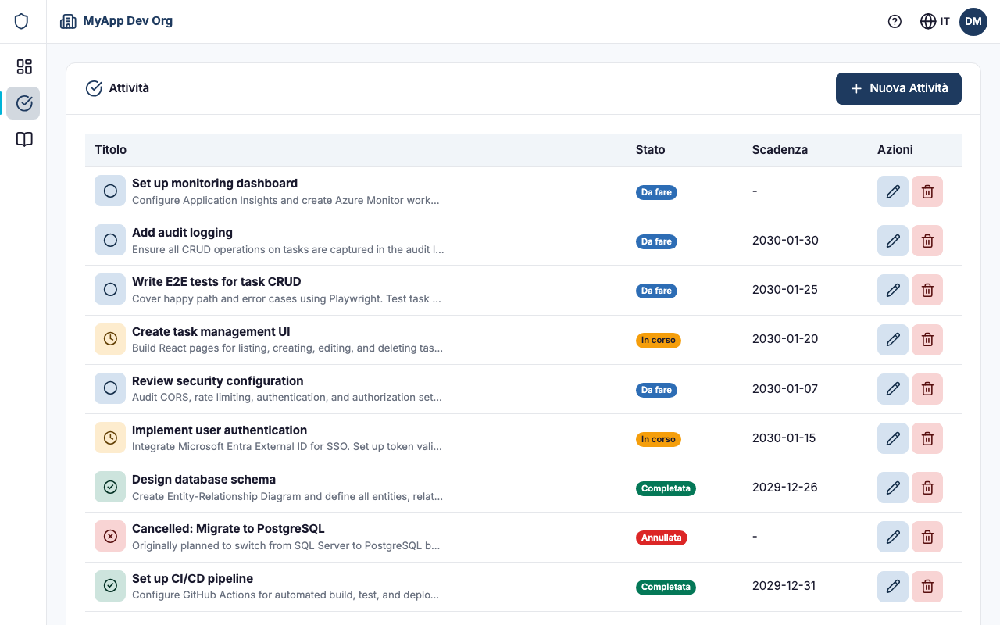

# Cambiare lo stato di un'attività

Fai avanzare un'attività con un solo clic, così tutti vedono a che punto è il lavoro.

## Prima di iniziare

- Solo gli Admin e gli Editor possono farlo. I Visualizzatori vedono lo stato ma non il pulsante "Cambia stato".

## Passaggi

1. Nel menu, fai clic su "Attività".
2. All'inizio della riga dell'attività fai clic sul pulsante "Cambia stato" (l'icona rotonda).

   
3. Fai di nuovo clic per portare l'attività allo stato successivo.

## Cosa vedrai

- Lo stato sulla riga cambia subito, senza lasciare la pagina.
- Titolo, descrizione e scadenza restano gli stessi.

## Da sapere

- L'ordine è "Da fare", "In corso", "Completata" e poi di nuovo "Da fare".
- Un'attività "Annullata" torna a "Da fare", mai direttamente a "In corso" o "Completata".
- Il pulsante non può annullare un'attività né saltare a uno stato scelto da te. Per questo usa il modulo di modifica.

## Se qualcosa non va

| Cosa vedi | Cosa fare |
|---|---|
| "Questa attività non esiste più." | Un altro membro l'ha eliminata. Continua con l'elenco aggiornato, dove l'attività non compare più. |

## Pagine correlate

- [Creare un'attività](US-TASK-01.md)
- [Modificare un'attività](US-TASK-02.md)
- [Eliminare un'attività](US-TASK-04.md)
- [Vedere l'elenco delle attività](US-TASK-05.md)
