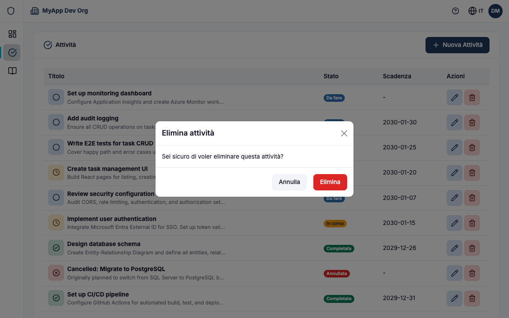

# Eliminare un'attività

Togli un'attività che non ti serve più, così l'elenco mostra solo il lavoro che conta.

## Prima di iniziare

- Solo gli Admin e gli Editor possono eliminare le attività. I Visualizzatori non vedono il pulsante "Elimina".

## Passaggi

1. Nel menu, fai clic su "Attività".
2. Sulla riga dell'attività fai clic sul pulsante "Elimina" (il cestino). Il dialogo "Elimina attività" chiede "Sei sicuro di voler eliminare questa attività?"

   
3. Fai clic su "Elimina" nel dialogo per confermare, oppure su "Annulla" per tenere l'attività.

## Cosa vedrai

- Il dialogo si chiude e l'attività non è più nell'elenco.
- Se era l'ultima attività, la pagina mostra "Nessuna attività".

## Da sapere

- Un'attività eliminata non si può ripristinare.
- Le attività si eliminano una alla volta.

## Se qualcosa non va

| Cosa vedi | Cosa fare |
|---|---|
| "Questa attività non esiste più." | Un altro membro l'ha eliminata prima di te. Continua con l'elenco aggiornato, dove l'attività non compare più. |

## Pagine correlate

- [Creare un'attività](US-TASK-01.md)
- [Modificare un'attività](US-TASK-02.md)
- [Cambiare lo stato di un'attività](US-TASK-03.md)
- [Vedere l'elenco delle attività](US-TASK-05.md)
