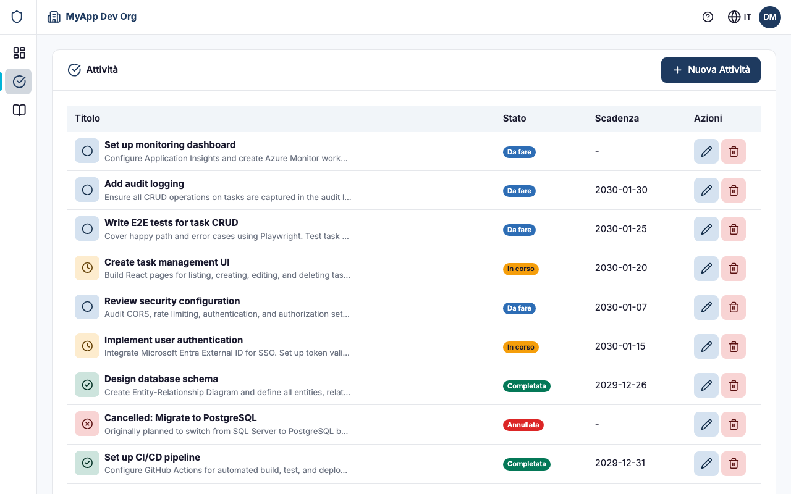
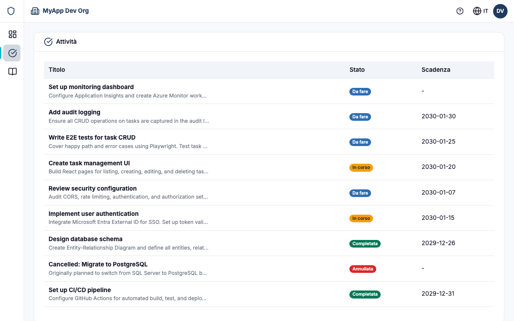
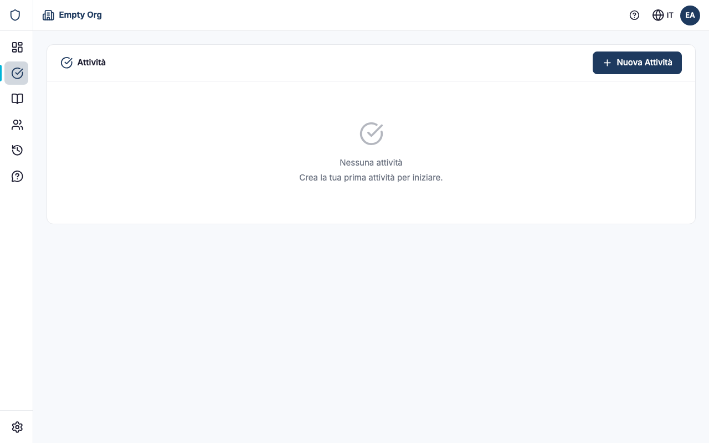
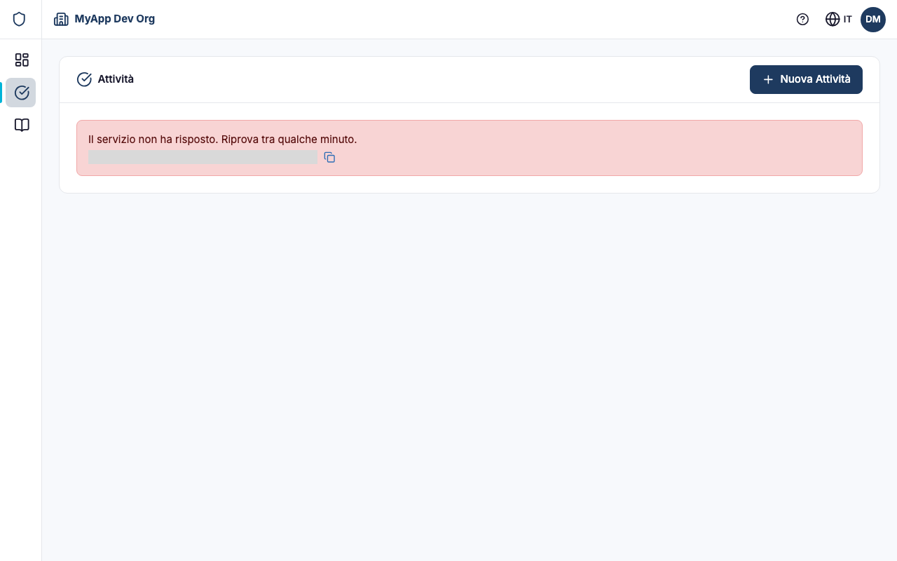

# Vedere l'elenco delle attività

Guarda tutte le attività della tua organizzazione, così sai su cosa sta lavorando il team.

## Passaggi

1. Nel menu, fai clic su "Attività".

   

## Cosa vedrai

- Una tabella con le colonne "Titolo", "Stato" e "Scadenza". Gli Admin e gli Editor vedono anche "Azioni".
- Ogni riga mostra il titolo, sotto di esso la descrizione in carattere più piccolo e lo stato come etichetta colorata.
- Un'attività senza scadenza mostra "-".
- Mentre le attività si caricano, al posto della tabella compare un indicatore di caricamento.
- Quando non ci sono attività, la pagina dice "Nessuna attività". Gli Admin e gli Editor leggono anche "Crea la tua prima attività per iniziare."

## Da sapere

- L'attività più recente è in cima all'elenco.
- L'elenco mostra le 50 attività più recenti della sola organizzazione corrente; non ci sono ricerca, filtri né pagine.
- I Visualizzatori leggono l'elenco ma non vedono i pulsanti per creare, modificare, cambiare lo stato o eliminare le attività.
- L'elenco non indica a chi è assegnata un'attività.

## Se qualcosa non va

| Cosa vedi | Cosa fare |
|---|---|
| "Il servizio non ha risposto. Riprova tra qualche minuto." | Ricarica la pagina più tardi. |

## Pagine correlate

- [Creare un'attività](US-TASK-01.md)
- [Modificare un'attività](US-TASK-02.md)
- [Cambiare lo stato di un'attività](US-TASK-03.md)
- [Eliminare un'attività](US-TASK-04.md)
